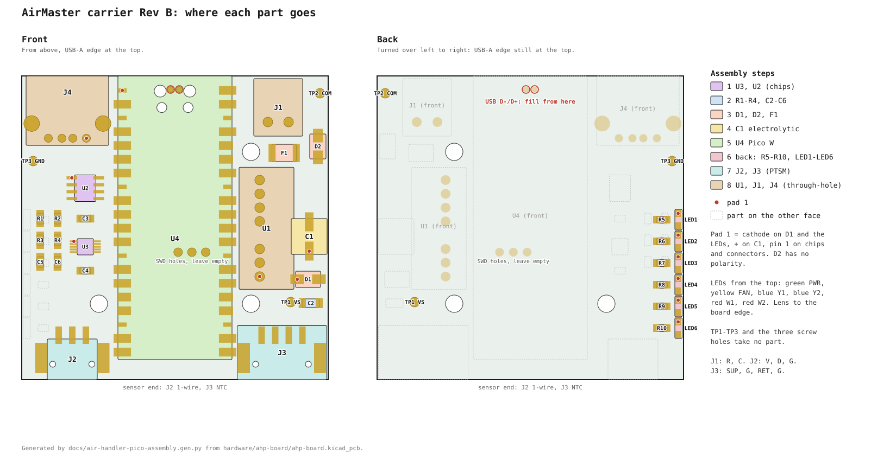

<!-- SPDX-License-Identifier: CC-BY-NC-4.0 -->
<!-- Copyright David Lewis -->

# AirMaster carrier Rev B: build sheet

This sheet covers the Pico W carrier in `hardware/ahp-board/` as fabricated by JLC: the board of
`docs/air-handler-shield-pcb-plan.md` §0, in a Hammond 1593K. Every joint is made with the iron. The JLC stencil is
not used, because its U4 openings are the library's oversized ones and the back of the board has no stencil.

## Parts for one board

Source says where the part on the bench comes from: the Digi-Key orders of 2026-10-31 (sales order 102617558) and
2026-11-10 (sales order 102840140), the Mouser order of 2026-11-10, or the spares from the rev A shield's Mouser order,
which bought parts for five boards, under its rev A reference. Between them they cover five carriers.

| Ref | Part number | Description | Source |
|---|---|---|---|
| U4 | SC0918 | Pico W | Digi-Key 10-31 (2), Mouser 11-10 (3) |
| U3 | ADS1115IDGSR | 16-bit ADC, VSSOP-10 | Digi-Key 10-31 |
| U2 | DS2482S-100+T&R | I2C 1-wire master, SOIC-8 | Digi-Key 10-31 |
| U1 | TMR 3-4811WI | 24 V to 5 V converter, SIP-8 | rev A U1, three in hand |
| U1 | TEC 3-4811WI | the same, Traco's newer series | Digi-Key 11-10 (2), note 3 |
| R1, R2 | RC0805FR-074K7L | 4.7 k, 1 %, 0805 | rev A R13–R15 |
| R3, R4 | RT0805BRD0710KL | 10 k, 0.1 %, 0805 | Digi-Key 10-31 |
| R5–R10 | RC0805FR-07220RL | 220 Ω, 0805 | Digi-Key 10-31 (25) |
| R5–R10 | ERJ-6ENF2200V | 220 Ω, 1 %, 0805, same pads | Mouser 11-10 (100) |
| C1 | UUD1H470MCL1GS | 47 µF 50 V can, 6.3 mm | Digi-Key 11-10 |
| C2 | GCJ31CR71A106KA13L | 10 µF, 1206 | rev A C2 |
| C3–C6 | CC0805KRX7R9BB104 | 100 nF, 0805 | Digi-Key 10-31 |
| F1 | 1812L020/60DR | PTC fuse 0.2 A, 1812 | rev A F1, F2 |
| D1 | S1M-E3/61T | rectifier 1 kV 1 A, SMA | Digi-Key 10-31 |
| D2 | SMAJ43CA | TVS 43 V, SMA | Digi-Key 10-31 |
| LED1 | LTST-S220KGKT | green, side-firing, PWR | Digi-Key 10-31 |
| LED2 | LTST-S220KSKT | yellow, side-firing, FAN | Digi-Key 10-31 |
| LED3, LED4 | LTST-S220TBKT | blue, side-firing, Y1, Y2 | Digi-Key 10-31 |
| LED5, LED6 | LTST-S220KRKT | red, side-firing, W1, W2 | Digi-Key 10-31 |
| J1 | Bonsicoky 3.81 mm 2-pin | 24 VAC header and plug | Amazon, in hand |
| J2 | 1778777 | PTSM 3-pin header, 1-wire | rev A TB3, Mouser 11-10 |
| J2 plug | 1778845 | PTSM 3-pin plug | rev A TB3, Mouser 11-10 |
| J3 | 1778780 | PTSM 4-pin header, NTC | rev A TB2, Mouser 11-10 |
| J3 plug | 1778858 | PTSM 4-pin plug | rev A TB2, Mouser 11-10 |
| J4 | 61400416021 | Würth USB-A, through-hole | Digi-Key 11-10 |
| Box | 1593KGY | Hammond box, grey | Digi-Key 10-31 (2), 11-10 (5) |
| Screws | 1593ATS50 | #4 × 1/4, three per board | Digi-Key 10-31 |

1. C1 is the Nichicon UUD1H470MCL1GS, 6.3 mm across and 8 mm tall at most on a 6.6 mm land. The rev A shield's C1
   (EEE-FK1J101P, 100 µF 63 V) is an 8 mm can and does not fit, and neither does the Panasonic EEE-FK1H470P, which
   is also 8 mm. The UCD1H470MCL1GS is a direct substitute.
2. The rev A D1 (S1M-13-F) fits D1's pads if the Vishay part runs short. The rev A C4–C6 are the same part as C3–C6.
3. The TEC 3-4811WI has the TMR's pins (1 −Vin, 2 +Vin, 3 Remote, 6 +Vout, 7 −Vout), 18–75 V in, 5 V at 600 mA, a
   21.8 × 9.1 mm body and no minimum load, so it fits U1's footprint and takes the boards beyond the three TMRs in hand.
   Mouser 495-TEC3-4811WI, Digi-Key 1951-1492-ND. Avoid the TMR 3-4811WIE: it needs 150 mA minimum load, above
   the node's 90 mA, and Traco no longer recommends it.
4. TP1–TP3 and the three screw holes take no part. TP1 and TP2 take a probe hook, and TP3 is the low-side ground.

## Assembly order

Work flattest to tallest. Front parts go on while nothing stands beside them, the back follows while the board can
still lie flat on the Pico, and the through-hole parts go last. For each two-pad part, tin one pad, slide the part in
against the molten tin, solder the other end, then reflow the first. Check the red dot on the drawing before
soldering anything with a pad 1.

1. **U3, then U2.** U3 is the finest pitch on the board (0.5 mm). Tin one corner pad, place the chip with its dot to
   pad 1, tack pin 1 and the opposite corner, and check all ten pins sit on their pads. Flux the rows, drag-solder
   them, and wick off any bridge. Then U2 the same way; read its marking first, which must say DS2482 and -100.
2. **R1–R4, C2–C6.** R3 and R4 are the 0.1 % parts; keep them apart from R1 and R2 (4.7 k). C2 is the 1206 beside
   U1's footprint.
3. **D1, D2, F1.** D1's band goes to the dot. D2 is bidirectional and F1 has no polarity.
4. **C1.** The can's + pad is the dot; the black stripe on the can marks the minus side.
5. **U4, the Pico W.** Pin 1 and the micro-USB go to the top, over the four clearance holes. Tack two diagonally
   opposite castellations, check that every pad is centred, then solder the rest with flux. Pins 35 and 36 have
   shortened pads beside a screw head; keep the solder off the mask there. Turn the board over and fill the two small
   plated holes ringed in red: hold the iron on the ring and feed solder until the hole fills and wets the Pico's
   pad above it. These are the USB D- and D+ to J4, and J4 is dead without them. The three plated holes in the
   middle line up with the Pico's SWD pads and connect to nothing; leave them empty.
6. **Back: R5–R10, then LED1–LED6.** Lay the board on the Pico. Each LED's lens faces the board edge, and its
   cathode (the dot, the square pad) is toward the USB-A edge; the cathode mark on the LED's rear face stands nearer
   the cathode end. From the USB-A edge: green PWR, yellow FAN, blue Y1, blue Y2, red W1, red W2. Keep the iron
   brief, because the lens is plastic.
7. **J2, J3.** Push each PTSM header's pegs into their holes with the entry face flush to the board edge, solder one
   end anchor, check it sits square, then the contacts and the other anchor. Keep the iron off the housing.
8. **U1, J1, J4.** U1's pin 1 is the dot. J1's entry faces the top edge. J4's opening faces past the top edge;
   solder both shield legs fully through, because they take the force of a plug. Wash the board with isopropyl
   alcohol, around U3 most of all, where flux residue leaks current into the NTC readings.

## Checks

The meter checks, flashing and the first run are on one page in `docs/air-handler-pico-revb-checkout.md`.

The drawing is generated by `docs/air-handler-pico-assembly.gen.py` from the board file.
