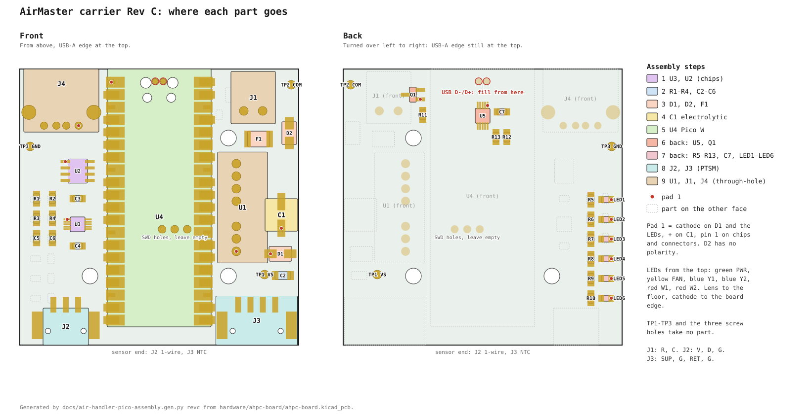

<!-- SPDX-License-Identifier: CC-BY-NC-4.0 -->
<!-- Copyright David Lewis -->

# AirMaster carrier Rev C: build sheet

This sheet covers the Pico W carrier in `hardware/ahpc-board/`: the Rev C board of
`docs/air-handler-shield-pcb-plan.md` §0, in a Hammond 1593K. Every joint is made with the iron; the board has no
stencil. Rev C adds the USB lockout on the back (Q1, U5 and their parts), so a laptop may be plugged into the
micro-USB with 24 VAC on, and it puts the status LEDs on the back, shining through six holes in the base's floor.

## Parts for one board

Source says where the part on the bench comes from: the Digi-Key orders of 2026-10-31 and 2026-11-10, the Mouser
order of 2026-11-10, the spares from the rev A shield's Mouser order under its rev A reference, the Amazon LED kit,
or the next order.

| Ref | Part number | Description | Source |
|---|---|---|---|
| U4 | SC0918 | Pico W | Digi-Key, Mouser |
| U3 | ADS1115IDGSR | 16-bit ADC, VSSOP-10 | Digi-Key 10-31 |
| U2 | DS2482S-100+T&R | 1-wire master, SOIC-8 | Digi-Key 10-31 |
| U1 | TEC 3-4811WI | 24 V to 5 V, SIP-8 | Digi-Key 11-10 |
| U5 | FSUSB42MUX | USB 2.0 switch, MSOP-10 | next order |
| Q1 | DMG2305UX-7 | P-FET, SOT-23 | next order |
| R1, R2 | RC0805FR-074K7L | 4.7 k, 0805 | rev A R13–R15 |
| R3, R4 | RT0805BRD0710KL | 10 k, 0.1 %, 0805 | Digi-Key 10-31 |
| R5–R10 | ERJ-6ENF2200V | 220 Ω, 0805 | Mouser 11-10 |
| R11 | RC0805FR-07100KL | 100 k, 0805 | next order |
| R12 | RC0805FR-0722KL | 22 k, 0805 | next order |
| R13 | RC0805FR-0733KL | 33 k, 0805 | next order |
| C1 | UUD1H470MCL1GS | 47 µF 50 V can | Digi-Key 11-10 |
| C2 | GCJ31CR71A106KA13L | 10 µF, 1206 | rev A C2 |
| C3–C7 | CC0805KRX7R9BB104 | 100 nF, 0805 | Digi-Key 10-31 |
| F1 | 1812L020/60DR | PTC fuse 0.2 A, 1812 | rev A F1, F2 |
| D1 | S1M-E3/61T | rectifier, SMA | Digi-Key 10-31 |
| D2 | SMAJ43CA | TVS 43 V, SMA | Digi-Key 10-31 |
| LED1 | 0805 green | PWR | Amazon kit |
| LED2 | 0805 yellow | FAN | Amazon kit |
| LED3, LED4 | 0805 blue | Y1, Y2 | Amazon kit |
| LED5, LED6 | 0805 red | W1, W2 | Amazon kit |
| J1 | 3.81 mm 2-pin | 24 VAC header, plug | Amazon, in hand |
| J2 | 1778777, 1778845 | PTSM 3-pin, plug | Mouser 11-10 |
| J3 | 1778780, 1778858 | PTSM 4-pin, plug | Mouser 11-10 |
| J4 | 61400416021 | USB-A, through-hole | Digi-Key 11-10 |
| Box | 1593KGY | Hammond box, grey | Digi-Key |
| Screws | 1593ATS50 | #4 × 1/4, three | Digi-Key 10-31 |

1. The next order: U5, Mouser 512-FSUSB42MUX or Digi-Key FSUSB42MUXCT-ND. Q1 from Digi-Key (DMG2305UX-7DICT-ND),
   because Mouser has the -7 reel out of stock to 2027-05-21; its 621-DMG2305UX-13 is the same part on a larger
   reel. R11–R13 on Mouser are 603-RC0805FR-07100KL, 603-RC0805FR-0722KL and 603-RC0805FR-0733KL. Add ten 100 Ω
   0805s, Panasonic ERJ-6ENF1000V (Mouser 667-ERJ-6ENF1000V), for note 3. Open each page and confirm stock before
   ordering. U5 and Q1 are surface-mount on the board's own pads and need no breakout.
2. The LEDs are the 200-piece 0805 kit, Amazon B09Y1K1MFD, five colours with 40 of each. They are unbranded, so find
   each one's cathode with the meter's diode test before it goes on: the LED glows faintly when the red lead is on
   the anode, and the black lead then marks the cathode.
3. R5–R10 are 220 Ω. A blue or green kit LED runs about 1 mA on them from 3.3 V; if one is too dim through the
   floor, change its resistor to 100 Ω.
4. C1, U1 and the Rev B notes on them hold here: C1 is 6.3 mm across at most, the TEC 3-4811WI takes U1's footprint,
   and the TMR 3-4811WIE does not suit (`docs/air-handler-pico-assembly.md`, notes 1 and 3).
5. TP1–TP3 and the three screw holes take no part.

## Assembly order

Work flattest to tallest. The front chips and passives go on first, then the Pico; the back follows with the board
lying on the Pico, and the through-hole parts go last. For each two-pad part, tin one pad, slide the part in against
the molten tin, solder the other end, then reflow the first. Check the red dot on the drawing before soldering any
part with a pad 1.

1. **U3, then U2.** U3's pitch is 0.5 mm. Tin one corner pad, place the chip with its dot to pad 1, tack pin 1 and
   the opposite corner, and check that all ten pins sit on their pads. Flux the rows, drag-solder them and wick off
   any bridge. Then U2 the same way; its marking must say DS2482 and -100.
2. **R1–R4, C2–C6.** R3 and R4 are the 0.1 % parts; keep them apart from R1 and R2. C2 is the 1206 beside U1.
3. **D1, D2, F1.** D1's band goes to the dot. D2 and F1 have no polarity.
4. **C1.** The + pad is the dot; the can's stripe marks the minus side.
5. **U4, the Pico W.** Pin 1 and the micro-USB go to the top. Tack two diagonally opposite castellations, check
   that every pad is centred, then solder the rest with flux. Turn the board over and fill the two small plated
   holes ringed in red: hold the iron on the ring and feed solder until the hole fills and wets the Pico's pad
   above. They carry USB D+ and D− to U5. The three plated holes in the middle are the Pico's SWD pads and stay
   empty.
6. **Back: U5, then Q1.** Lay the board on the Pico. U5 is 0.5 mm pitch like U3: its dot to pad 1, which is at the
   top, toward the two USB holes. Tack and check, then drag-solder with flux and wick any bridge. Check with a lens
   that the two tracks from the USB holes are not bridged to each other. Q1's pin 1 is the dot.
7. **Back: R11–R13, C7, R5–R10, then LED1–LED6.** R11 stands beside Q1, C7 beside U5 with its pad 1 toward U5, and
   R12 and R13 below U5. Then the LED resistors, then the LEDs: lens away from the board, cathode to the outer pad
   at the board edge (the red dot), from the top green PWR, yellow FAN, blue Y1, blue Y2, red W1, red W2. Keep the
   iron brief on the LEDs, because the lens is plastic.
8. **J2, J3.** Push each PTSM header's pegs into their holes with the entry face flush to the board edge, solder one
   end anchor, check it sits square, then the contacts and the other anchor. Keep the iron off the housing.
9. **U1, J1, J4.** U1's pin 1 is the dot. J1's entry faces the top edge. J4's opening faces past the top edge;
   solder both shield legs fully through. Wash the board with isopropyl alcohol, around U3 and U5 most of all.

## The box

1. Print `hardware/ahpc-board/ahpc-led-drill-template.pdf` at 100 % and check its 50 mm bar.
2. Cut the template out and cut out its two screw circles. Close the empty box with its two cover screws, lay the
   template on the outside of the floor with TOP PANEL toward the J1 end, the circles round the screw heads, and
   tape it.
3. Open the box, centre-punch each cross, and drill 1.5 mm, then 3 mm, at low speed. Deburr the inside.
4. Fit the label after the board is in: print `hardware/label/airmaster-label-revc.pdf` at 100 %, cut on the grey
   line, and lay it with its right slot over the holes and its notches at the screws.

## Checks

Unpowered, nothing on the micro-USB:

| Between | Expect |
|---|---|
| TP2 (COM) and TP3 (GND) | open |
| TP1 (VS) and TP2 | no short |
| J1 R and C | no short |
| U4 pin 40 (VBUS) and GND | no short |
| U4 pin 39 (VSYS) and GND | no short |
| U4 pin 36 (3V3) and GND | no short |
| TP2 and TP3 holes | no short to each other |

1. The TP2 and TP3 in the last row are the Pico's USB holes (D− and D+), ringed in red on the back; the test loops
   TP2 and TP3 are the ones in the rows above.

Powered from a bench 24 VAC transformer on J1, micro-USB empty:

| Between | Expect |
|---|---|
| TP1 and TP2 | about 35 V DC |
| U4 pin 39 (VSYS) and GND | about 5 V |
| U4 pin 40 (VBUS) and GND | 0 V |
| U4 pin 36 (3V3) and GND | 3.3 V; LED1 lit |
| U5 pin 10 (OE) and GND | 0 V |
| J4 pin 1 and GND | 5.1 V |

Then plug a laptop into the micro-USB, 24 VAC still on:

| Between | Expect |
|---|---|
| U4 pin 40 (VBUS) and GND | 5 V, from the laptop |
| U4 pin 39 (VSYS) and GND | about 4.7 V |
| U5 pin 10 (OE) and GND | about 3.0 V |
| J4 pin 1 and GND | 5.1 V, still |

Last, unplug J1 with the laptop still on: J4 pin 1 falls to 0 V, because Q1 keeps the laptop's 5 V off U1's rail,
and LED1 stays lit from the laptop.

Load `AirHandlerPico` from `~/github/Arduino` by holding BOOTSEL while plugging in the laptop; with 24 VAC on or off
makes no difference to the board. Until the sketch watches VBUS on WL_GPIO2 and stops its USB host (plan §0 item 3),
the running sketch offers the laptop no serial port, so use BOOTSEL for every load.

The drawing is generated by `python3 docs/air-handler-pico-assembly.gen.py revc` from the board file.
