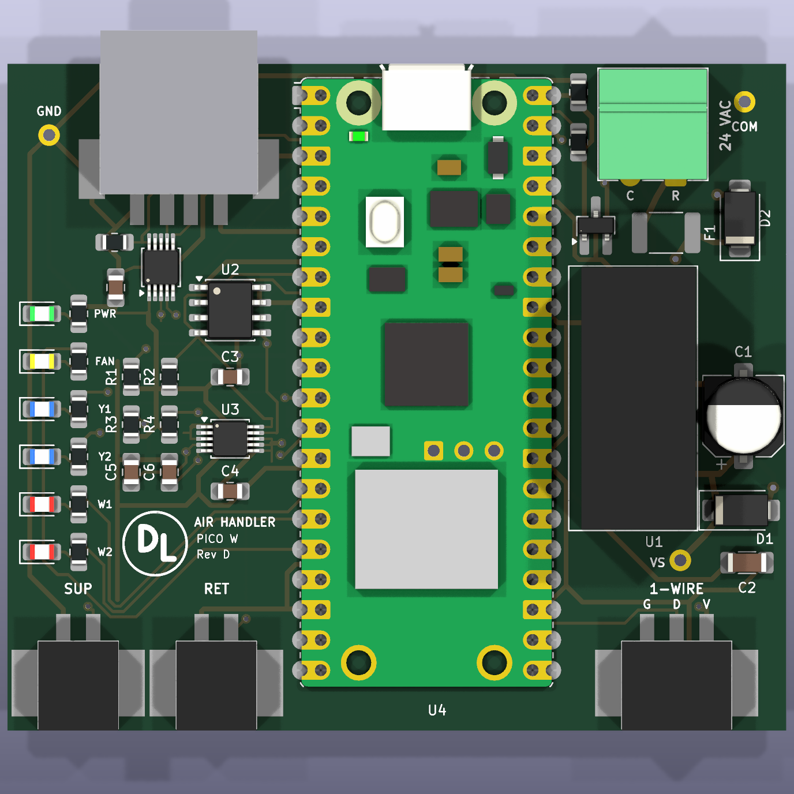
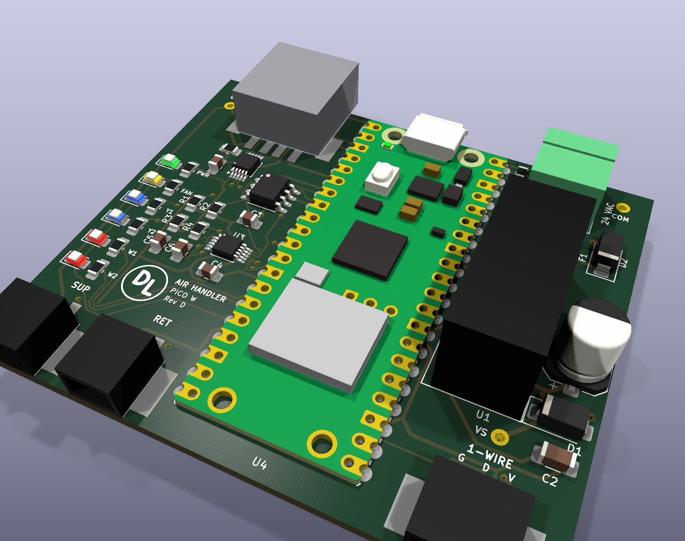
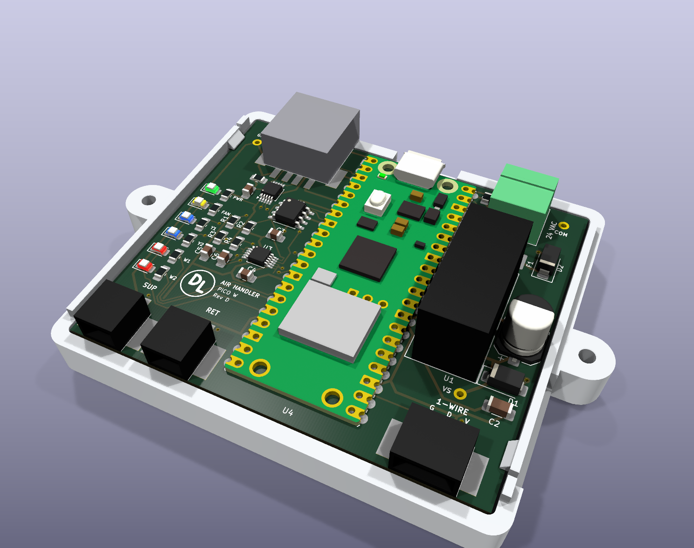
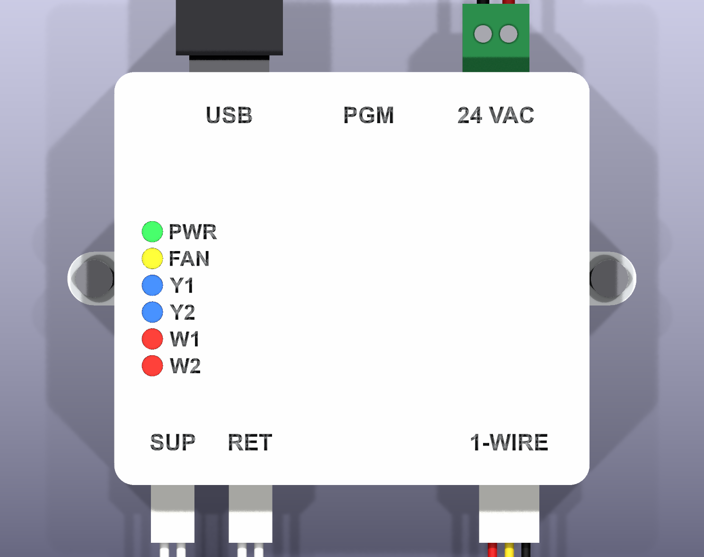
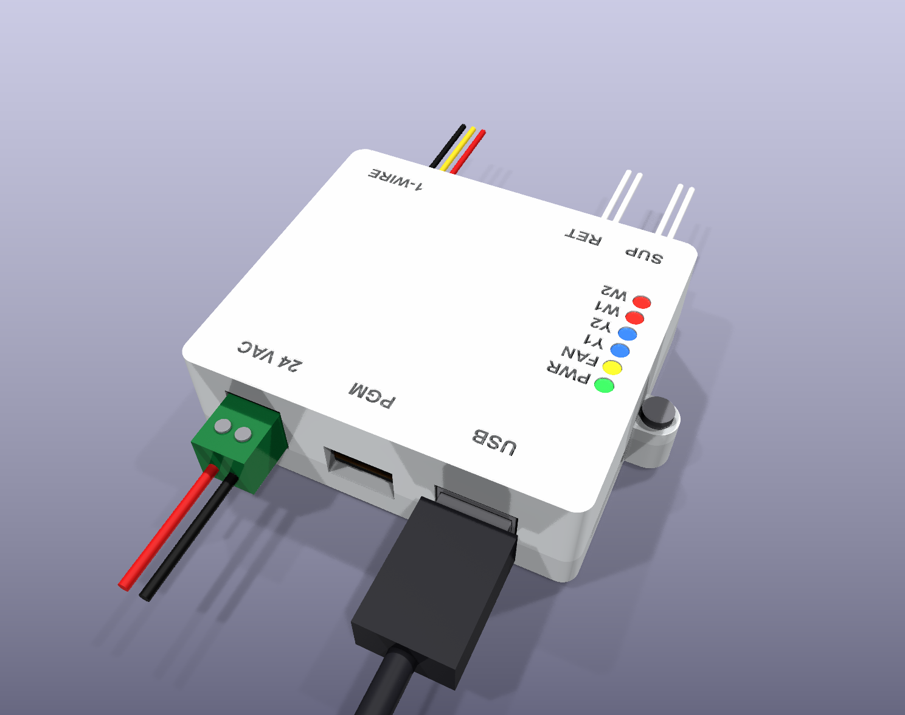
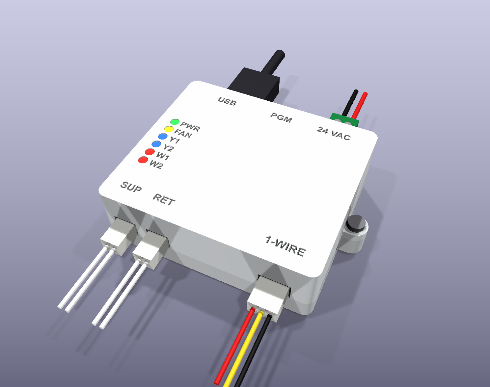
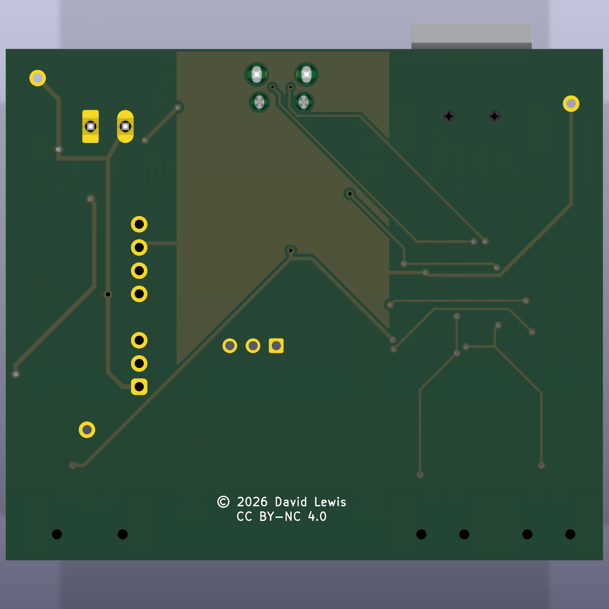

<!-- SPDX-License-Identifier: CC-BY-NC-4.0 -->
<!-- Copyright David Lewis -->
# AirMaster carrier Rev D and its printed case

Rev D is the AirMaster Pico W carrier laid out for a fabricator to assemble and for a printed case. Every part is on the front, every part is in JLCPCB's assembly stock, and the board has no holes. The circuit and the Pico's pin assignments are Rev C's (`docs/air-handler-shield-pcb-plan.md` §0), so the `AirMaster` firmware runs on it unchanged. Nothing is ordered.

## How Rev D differs from Rev C

| Subject | Rev C | Rev D |
|---|---|---|
| Board | 56.4 × 56 mm | 65.4 × 56 mm |
| Mounting | 3 screws, 2 notches | none; the case clamps it |
| Back | 18 parts | bare |
| LEDs | back, through the floor | front, under the cap |
| USB pair | holes filled by hand | pads joined in the oven |
| Air sensors | one 4-pin header | two 2-pin headers |
| USB-A jack | through-hole | surface-mount |
| U1 | TMR 3-4811WI | URB4805S-3WR3 |
| D1 | S1M | M7 |
| C2 | 10 µF | 100 µF 6.3 V |
| Box | Hammond 1593K | printed tray and cap |

## The board

`hardware/gen-ah-pico-d.py` generates it in `hardware/ahpd-board/`, and `sh hardware/ahpd-build.sh` routes it, checks it and exports the gerbers and JLCPCB's two files. The finished board runs x 0.3–65.7, y 0–56. The top edge carries the USB-A jack, the Pico's micro-USB and the 24 VAC header. The bottom edge carries the two air-sensor headers on the left and the 1-wire header on the right, with the Pico's antenna between them.

| Ref | Part | LCSC |
|---|---|---|
| U4 | Raspberry Pi Pico W | C7203003 |
| U1 | URB4805S-3WR3 | C20198635 |
| U2 | DS2482S-100+ | C143306 |
| U3 | ADS1115IDGS | C37593 |
| U5 | FSUSB42MUX | C11355 |
| Q1 | DMG2305UX-7 | C150470 |
| J1 | Phoenix 1803277 | C480537 |
| J2 | Phoenix 1778777 | C3583902 |
| J3, J5 | Phoenix 1778764 | C5149246 |
| J4 | HRO U-A-24SS-W-1 | C283549 |
| F1 | 1812L020/60DR | C315900 |
| D1 | M7 | C95872 |
| D2 | SMAJ43CA | C223990 |
| C1 | 47 µF 50 V | C445256 |
| C2 | 100 µF 6.3 V 1206 | C15008 |
| C3–C7 | 100 nF 0805 | C49678 |
| R1, R2 | 4k7 0805 | C17673 |
| R3, R4 | 10k0 0.1 % 0805 | C110775 |
| R5–R10 | 220 Ω 0805 | C17557 |
| R11 | 100 k 0805 | C149504 |
| R12 | 22 k 0805 | C17560 |
| R13 | 33 k 0805 | C17633 |
| LED1 | green 0805 | C2297 |
| LED2 | yellow 0805 | C2296 |
| LED3, LED4 | blue 0805 | C2293 |
| LED5, LED6 | red 0805 | C84256 |

1. U4: the footprint is KiCad's hand-solder Pico W pattern with two 1.4 mm pads added under the Pico's TP2 (D−) and TP3 (D+), where KiCad's reflow pattern has them. Each pad has a 1.7 mm stub to a via, and the pair runs on the back to U5. The paste layer opens each castellated pad over its own copper (`hardware/ahp-paste.py`).
2. U1: the footprint takes the URB4805S-3WR3 and the Traco TMR 3-4811WI. Both have the same pins at the same positions. The URB's body is 9.5 mm thick with its pin row 2.5 to 2.7 mm from the face nearest the Pico, so it reaches 1.4 mm further toward C1 than the Traco, and C1, D1 and C2 stand 0.7 mm clear of it. Pin 8 has a hole and no net: it is an internal node on the HI-LINK and YLPTEC parts. Pin 3, the remote input, is open, which runs every make.
3. U1: the URB needs a 30 mA load at 5 V for its ripple figure. The node draws about 90 mA with the Unico USB board (plan §0, bench results).
4. C2: HI-LINK's application circuit puts 100 µF on the output and Mornsun's 10 µF. 100 µF is inside the limit of each converter, the Traco's 1,680 µF included.
5. J3, J5: one 2-pin header for each air sensor, `SUP` then `RET`, beside U3 and its dividers. A 10K NTC has no polarity. The two plugs are alike, so mark them. JLCPCB had no stock of the 4-pin header, 1778780, on 2026-11-16.
6. J2: the 1-wire header, pins V, D, G from the right, on the right of the antenna.
7. U1, J1: through-hole, nine joints. JLCPCB solders them, or they take three minutes with the iron. The surface-mount converters of this rating (Traco TMR 3-4811WISM, TDN 3-4811WISM) cost $45 to $49 at JLCPCB against $3.59.
   J1: the 3.81 mm header of Rev B and Rev C, so the 24 VAC screw plug is unlike every other plug on the board and cannot enter a sensor header.
   J4: a surface-mount USB-A jack: four signal pads, a 2.2 × 5.0 mm shell pad each side and two plastic pegs in unplated 1.3 mm holes. Its face stands 2.8 mm past the board edge, flush with the outside of the tray's wall, which keeps its pads clear of U5. Pads are from HRO's drawing and JLCPCB's footprint.
8. LED1–LED6: one column down the left strip at x 3.2, y 21 to 41, 4 mm apart, cathodes outboard on a ground bus that runs up to the GND test loop. The names are on the silkscreen beside the resistors and cut into the cap.
9. U5, C7, R13: under the jack's pins, with U5's HSD1 pair going straight up into the jack's pins 2 and 3. Q1, R11 and R12 stand beside the Pico's VBUS and VSYS pins.
10. The licence legend is on the back under the Pico, since the sensor legends leave no room beside the title block.

The cap's four pins press the board at x 2.4, y 14.5; x 62.6, y 7.6; x 2.4, y 44.1; and x 49.5, y 42.0. The nearest pad to any of them is 0.95 mm away.

## The case

`hardware/ahpd-case.py`, run with `freecadcmd`, writes the tray and the cap to `hardware/ahpd-case/` as STEP and STL. Closed, the case is 71.0 × 61.6 × 22.1 mm, and 85.0 mm across its two ears.

| Item | Value |
|---|---|
| Wall | 2.4 mm |
| Floor, top | 2.0 mm |
| Board to wall | 0.4 mm |
| Posts under the board | 3.5 mm |
| Room above the board | 13.0 mm |
| Tray volume | 12.8 cm³ |
| Cap volume | 16.9 cm³ |
| Screws | 2, #4 × 1/4 thread-forming |

1. The seam is the board's top face. The tray holds the board on eight posts between its walls. The cap carries four tapered pins that press the board on to four of those posts.
2. Every connector stands in a notch in one of the cap's end walls, open at the seam, so the cap lifts off with the plugs in place. The tray's wall dips 2.2 mm under the micro-USB for the plug's overmould.
3. The cap's left wall carries a solid block over the LED column, 1.8 mm above the board, with a tapered bore over each LED, 2.0 mm across at the LED and 3.2 mm at the face. The block separates the six lights.
4. The cap's face carries the names cut 1.0 mm deep: `PWR FAN Y1 Y2 W1 W2` beside the bores, `USB`, `PGM` and `24 VAC` along the top edge, `SUP`, `RET` and `1-WIRE` along the bottom.
5. The inner half of each tray side wall stands 2 mm into a rabbet in the cap, which locates the cap.
   Two snap hooks hold the board in the tray with the cap off. Each is a 17.5 mm beam cut from that inner half, fixed near the ear and free toward one end, with a barb standing 0.8 mm over the board's edge: the left hook toward the top edge, the right hook toward the sensor edge. Pressing the board in bends each beam 1.2 mm outward, 1.0 % strain. A slot 18 mm long and 3.8 mm high in the tray wall behind each beam gives it room and takes a fingernail to release the board. The closed cap stands behind the beams' tops and locks them.
6. One ear at the middle of each side takes a #4 × 1/4 thread-forming screw, the Hammond 1593ATS50 screw of the Rev B and Rev C boxes: 3 mm of cap ear under the head and 3.3 mm of thread in a 2.5 mm pilot in the tray's ear.
7. The tray's floor goes to the air handler with VHB tape. Undoing the two screws leaves the tray and board on the wall.
8. Print the tray floor down and the cap face down. In MJF or SLS nylon neither needs support, and nylon suits the screws, the hooks and the lettering. The fits are sized for Xometry's SLS nylon 12 limits: ±0.38 mm on a dimension, 1 mm engraving depth, 0.5 mm between mating parts. The cap's rabbet clears the tray's lap by 0.3 mm a side and the slots round the hooks are 0.8 mm. A filament printer needs support under the two hook beams. A light colour shows the LEDs through the bore walls from off axis.
9. The script checks 26 part and plug bodies against both halves and stops if any shares volume with either.

`sh hardware/ahpd-render.sh docs` renders the board and the case.

## Ordering from JLCPCB

| JLCPCB asks for | File in `hardware/ahpd-board/` |
|---|---|
| Gerbers | `ahpd-board-gerbers.zip` |
| BOM | `ahpd-board-jlc-bom.csv` |
| CPL | `ahpd-board-jlc-cpl.csv` |

The assembly is one side: 40 parts on 26 BOM lines, 150 surface-mount joints and nine through-hole joints on U1 and J1. Eleven lines are basic parts and fifteen extended. The parts cost $27.99 a board, of which the Pico W is $12.84. Stock and prices are JLCPCB's of 2026-11-16.

Estimate for five boards on the Economic service, from JLCPCB's published fees:

| Item | USD |
|---|---|
| Parts | 140 |
| Extended parts, 15 at $3 | 45 |
| Setup and stencil, one side | 10 |
| Placement, 150 joints a board | 1 |
| Bare boards | 5–10 |
| Total | about 205 |

Through-hole soldering of U1 and J1 (about $4 an order by JLCPCB's FAQ), shipping and duty are extra. The upload shows whether the Economic service takes the Pico W and the headers; the Standard service adds about $58 at its two-sided rate. The case is quoted from the two STEP files.

## To check before ordering

1. Rotations. The placement file carries KiCad's angles. Check U4, U1, U2, U3, U5, Q1, C1, D1, D2 and the six LEDs in JLCPCB's placement preview.
2. The URB4805S-3WR3 on the bench: start-up on the half-wave rail, whose valley is about 27 V, and ripple at the node's load.
3. RSSI in the closed printed case, against the Rev B figure in the Hammond box.
4. LED brightness through the bores. A blue or green 0805 near 3 V forward runs about 1 mA through 220 Ω; 100 Ω is the next value.
5. The fit of the first print: the board in the tray and under its hooks, each plug through its notch, and the screws' bite in the chosen material.
