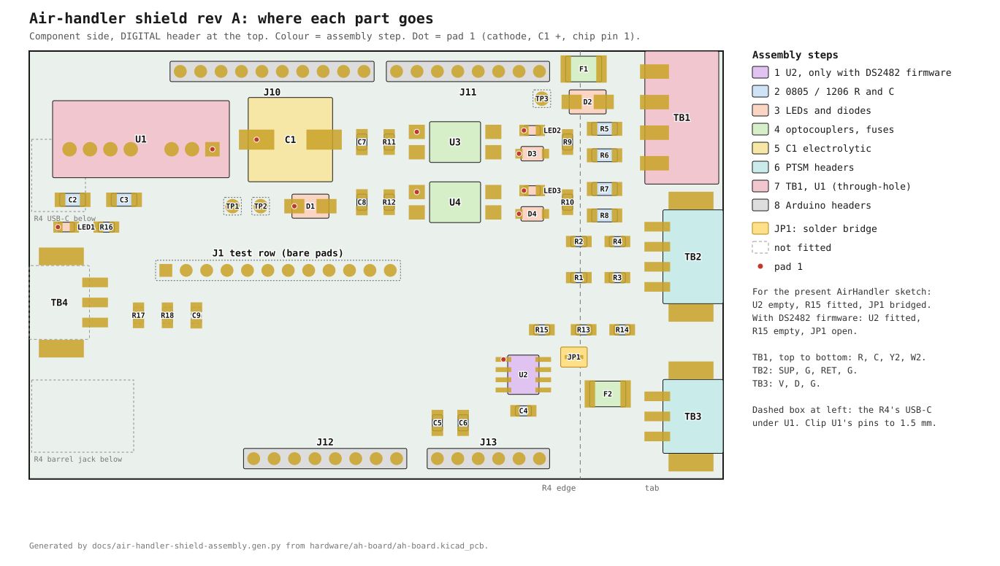

# Air-handler shield rev A: build sheet

This sheet covers the shield in `hardware/ah-board/` as fabricated: the UNO R4 WiFi shield with the 24 VAC converter,
the Y2 and W2 optocoupler inputs, the two air-temperature dividers and the DS2482 1-wire master. The serial tap in
`docs/air-handler-shield-pcb-plan.md` §4.3 belongs to a later revision and is not on this board.

Fit U2, leave R15 empty and leave JP1 open. The `AirHandler` sketches in `~/github/Arduino` find the DS2482 at
0x18 at boot and read the probes through it, and fall back to D2 when nothing answers. JP1 and R15 are the rollback for
a U2 that will not work: remove U2, bridge JP1 and fit R15, and the same firmware reads the bus on D2. Never bridge JP1
with U2 fitted, because D2 and the DS2482 would then drive the same wire. A zone sketch for this board defines
`SHIELD_PCB`, which reads return air on A0 and supply air on A1 as the board is wired.

## Parts for one board

Every part below except the Arduino headers is on the Mouser cart in OneDrive (`Claude/My Shopping Cart - Mouser.pdf`,
printed 2026-10-19), in quantities for five boards. Three lines there differ from the plan's part numbers and fit the
same pads: D1 is Diodes S1M-13-F, C2 is Murata GCJ31CR71A106KA13L and D2 is Bourns SMAJ43CA.

| Ref | Part | Qty | Mouser |
|---|---|---|---|
| U1 | Traco TMR 3-4811WI | 1 | 495-TMR-3-4811WI |
| U2 | ADI DS2482S-100+ | 1 | 700-DS2482S-100 |
| U3, U4 | Lite-On LTV-814S | 2 | 859-LTV-814S |
| F1, F2 | Littelfuse 1812L020/60DR | 2 | 576-1812L020/60DR |
| D1 | Diodes S1M-13-F | 1 | 621-S1M-F |
| D2 | Bourns SMAJ43CA | 1 | 652-SMAJ43CA |
| D3, D4 | Diodes 1N4148W-7-F | 2 | 621-1N4148W-F |
| C1 | Panasonic EEE-FK1J101P | 1 | 667-EEE-FK1J101P |
| C2 | Murata GCJ31CR71A106KA13L | 1 | 81-GCJ31CR71A106KA3L |
| C3 | Samsung CL31A226KPHNNNE | 1 | 187-CL31A226KPHNNNE |
| C4–C6 | Yageo CC0805KRX7R9BB104 | 3 | 603-CC805KRX7R9BB104 |
| C7, C8 | Murata GRM21BR71C105KA01L | 2 | 81-GRM40X105K16L |
| R1, R2 | Yageo RT0805BRD0710KL | 2 | 603-RT0805BRD0710KL |
| R3, R4, R9, R10, R16 | Yageo RC0805FR-071KL | 5 | 603-RC0805FR-071KL |
| R5–R8 | Yageo RC1206FR-072K2L | 4 | 603-RC1206FR-072K2L |
| R11, R12 | Yageo RC0805FR-0710KL | 2 | 603-RC0805FR-0710KL |
| R13–R15 | Yageo RC0805FR-074K7L | 3 | 603-RC0805FR-074K7L |
| LED1 | Lite-On LTST-C171GKT, green | 1 | 859-LTST-C171GKT |
| LED2 | Lite-On LTST-C171TBKT, blue | 1 | 859-LTST-C171TBKT |
| LED3 | Lite-On LTST-C171KRKT, red | 1 | 859-LTST-C171KRKT |
| TB1 header | Phoenix 1803293 | 1 | 651-1803293 |
| TB1 plug | Phoenix 1803594 | 1 | 651-1803594 |
| TB2 header | Phoenix 1778780 | 1 | 651-1778780 |
| TB2 plug | Phoenix 1778858 | 1 | 651-1778858 |
| TB3 header | Phoenix 1778777 | 1 | 651-1778777 |
| TB3 plug | Phoenix 1778845 | 1 | 651-1778845 |
| J10–J13 | Sullins PRPC040SAAN-RC, 40-way strip | 1 | not on the cart |
| — | Arduino UNO R4 WiFi | 1 | not on the cart |

1. Every part except U1, TB1 and the Arduino headers is surface-mount on the board's own pads, so none needs a breakout
   adapter. The passives are 0805 and 1206 on hand-solder pads.
2. R15 is fitted only for the JP1 rollback; the list carries one.
3. TB4, R17, R18 and C9 (the coil water meter option) stay empty. J1 and TP1–TP3 are bare test pads; J1 takes a
   1 × 12 pin header for a logic analyser if wanted.
4. The PTSM headers and plugs are the EXT rev C parts, so spare plugs may already be in the bench drawer.
5. The Arduino headers are cut from one 40-way 2.54 mm male strip into 10, 8, 8 and 6, which is 32 pins:
   [Digi-Key](https://www.digikey.com/en/products/detail/sullins-connector-solutions/PRPC040SAAN-RC/2775214),
   $1.23, stock not confirmed because the page refused an automated load;
   [Amazon](https://www.amazon.com/s?k=2.54mm+male+breakaway+header+40+pin). Any strip from the bench drawer serves.

## Assembly sequence

Work flattest to tallest on the component side, so the board lies flat on the bench for every surface-mount joint.
For each two-pad part, tin one pad, slide the part in against the molten tin, then solder the other end and reflow the
first. Check the dot on the drawing before soldering anything with a pad 1.

1. **U2, DS2482.** Read the chip's marking before it goes on: it must say DS2482 and -100. Any other SOIC-8 in this
   footprint can be reverse-powered, because pad 1 is +5 V and pad 8 is GND; an ICM7555 does exactly that and
   collapses the rail. Tin pad 1, place the chip with its dot to the pad-1 mark, tack pin 1 and
   the opposite corner, square it, then solder the rest and wick any bridges. It is the finest pitch on the board,
   so it goes on while nothing stands beside it.
2. **Resistors and ceramic capacitors.** R1–R14 and R16, C2–C8. R1 and R2 are the
   0.1 % parts; keep them apart from the 1 kΩ reel. R5–R8 are the 1206 2.2 kΩ parts beside TB1.
3. **LEDs and diodes.** LED1 green at the left edge, LED2 blue on the Y2 row, LED3 red on the W2 row; the cathode
   mark on the part goes to the dot. LED2 and LED3 carry the optocouplers' current, so a board without them needs
   a solder bridge or a lead offcut across each one's pads, or the input reads only one half of the AC cycle. LED1 is
   only the power lamp and can stay off with R16. D3 and D4 band to the dot. D1 band to the dot. D2 is
   bidirectional and goes either way.
4. **U3, U4 and the fuses.** Diode-test each optocoupler loose across pins 1 and 2 before fitting: 1.07 V in both
   directions. The pin-1 dot goes to the left, toward C7 and C8. Solder each foot in 2–3 s; both LTV-814s on the first
   board came off the iron with dead inputs. F1 at the top-right corner, F2 beside TB3; neither has a polarity.
5. **C1.** The 100 µF can's + pad is the dot, on the left toward U1; the black stripe on the can marks the minus side.
6. **TB2 and TB3.** Push each PTSM header's locating pegs into their holes with the entry face flush to the board edge,
   solder one end anchor, check it sits square, then the contacts and the other anchor.
7. **TB1 and U1.** TB1's entry faces the tab's edge; the wires land R, C, Y2, W2 from the top. U1 goes in with its
   pin 1 (the dot on the drawing) at the right, toward C1. Solder from the bottom, then clip U1's pins to 1.5 mm,
   because they pass over the R4's USB-C.
8. **Arduino headers.** Plug the four male headers into an R4, lay the shield over their pins and solder from the
   top. The shield should rest on the R4's barrel jack. Lift it off before the checks.

## Checks

Unpowered, R4 off:

| Between | Expect |
|---|---|
| J1.2 (+5) and J1.1 (GND) | no short |
| TP1 (VS) and TP2 (C) | no short |
| TP2 (C) and J1.1 (GND) | open: the isolation barrier |
| TB1 R and C | no short |

Powered from a bench 24 VAC transformer on TB1 R and C, R4 still off:

| Between | Expect |
|---|---|
| TP3 and TP2 | 24–28 VAC |
| TP1 and TP2 | about 35 V DC |
| J1.2 and J1.1 | 5.1 V; LED1 lit |
| J1.3 (Y2) and J1.1 | 5 V; under 0.5 V with R jumpered to Y2, LED2 lit |
| J1.4 (W2) and J1.1 | as Y2, with R jumpered to W2 and LED3 lit |
| J1.6, J1.7 and J1.1 | 2.5 V at 77 °F with an NTC on TB2; 5 V means open |
| J1.8 (1-wire V) and J1.1 | 5 V |
| J1.9 (1-wire D) and J1.1 | 5 V, held by U2 |
| J1.10 (SDA), J1.11 (SCL) and J1.1 | 5 V, from R13 and R14 |

Then power off, seat the R4 and power again from TB1 alone; the R4 runs from U1 through its 5V pin, so no USB cable
is needed, and a laptop on the USB-C at the same time is safe. Flash `AirHandlerBench` from `~/github/Arduino`
and watch its serial console at 115200. It prints `1-Wire master: DS2482 at 0x18` and the ROM of each DS18B20 on TB3
with `CRC ok`, then a line a second: the probe temperatures, A0 (return) and A1 (supply) following the two NTCs, and
D8 LOW while R is jumpered to Y2. `FAILED its reset` means U2 answers on I²C without power, so measure 5 V between its
pins 1 and 3; `no DS2482 at 0x18` means U2 is off the bus, so check its SDA and SCL joints. The R4 prints that banner
before a monitor can open the port, so type `r` to see it again, and `s` for the DS2482's own view of the line. `presence=0
short=0 line=high` with a probe plugged in and 5 V on both TB3.V and TB3.D is an open between U2 pin 2 and the probe's
DQ, and the first board's was a PTSM tail at TB3 that looked soldered: reflow all three tails before anything else.
Expect `presence=1` and the ROM within seconds of the reflow. A call that lights LED2 while J1.3 stays at 5 V points at U3 or
C7; a call at TB1 with LED2 dark points at R5, R6 or the LED's orientation. During a call a working U3 holds about 1.1 V AC
across its pins 1 and 2, measured at the legs. About 4.8 V AC there, with J1.3 at 5 V called or not, is a dead input,
and the first board's U3 and U4 both read so until replaced. A U3 turned 180° would instead hold J1.3 near 1 V with no call.
The W2 row reads the same way at U4 and J1.4.

Last, the run in service form: flash the zone sketch with `SHIELD_PCB` defined, unplug the USB and power from TB1 alone.
The node joins WiFi about 15 s after power-up and serves its line on port 80. Expect every sensor in the line, `y2` 1 while
R is jumpered to Y2 and 0 after it, and J1.4 under 0.5 V while R is jumpered to W2, since the sketch does not read D9. With
all-zero ROMs in the zone file the sketch scans the bus only at boot, so plug the probes in before power-up.
