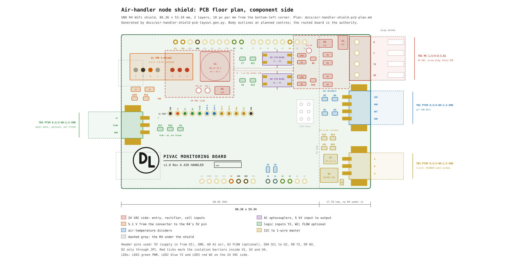

# Air-handler node shield: PCB plan

**Status:** Two routes, decided by one bench test. If the Adafruit Feather RP2040 USB Host board reads the Unico USB
board's frames, the node becomes the Pico W carrier of §0 in a DIN-rail module and this UNO shield is not built;
if it does not, this shield with the serial tap of §4.3 is the design, after the data-cable measurements.
`hardware/ah-board/` still carries the Y2 and W2 optocoupler inputs. Nothing ordered. · **Owner:** David

The first node, at the master bedroom, is an Arduino UNO R4 WiFi with a hand-wired Olimex PROTO-SHIELD, a DIN-rail 24 VAC to
USB-C buck converter, a Magnecraft 792 relay on a socket and nine feed-through blocks
(`docs/mbr-air-handler-node-plan.md`, `docs/mbr-air-handler-node-shield-review.md`). This board replaces the
proto-shield, the converter and the relay with one fabricated shield, and the same board serves any of the five
air handlers: the zone lives in the sketch and the pivac config, and a ZONE box on the silkscreen takes a marker. The field wiring lands on screw terminals along
one short edge. The 24 VAC is converted on the board through an isolated converter, as on the pivac EXT board, and
the DS18B20 water probes run from a DS2482 I2C master, as on EXT. A serial tap on the Unico Smart Control Board's data cable reads the six thermostat calls, the actual airflow and the fan RPM, and lets pivac set the stored airflows. Every part is surface-mount except the terminals, the converter and the Arduino
headers. `docs/air-handler-shield-pcb-layout.svg` is the floor plan, generated by
`docs/air-handler-shield-pcb-layout.gen.py`.

## 0. The USB route: a Pico W carrier in a DIN-rail module

The SCB's protocol is proven over the Unico USB board (A01470-G01, a Cypress CDC device) from a Mac and from the
Pi (`docs/unico-scb-live-test.md`), so the node can take the same path: plug into the control box's USB-B jack as a
USB host and leave the data cable alone. The UNO R4 cannot be a USB host, so the node's controller becomes a
Raspberry Pi Pico W (RP2040 with WiFi), whose host port is two GPIOs through Pico-PIO-USB and whose CDC host is
Adafruit TinyUSB's `serial_host_bridge` example. The one gate is a bench test: the Adafruit Feather RP2040 with USB
Type A Host (Adafruit 5723), which has the host jack and the 5 V boost already wired, runs the example with
`SerialHost.begin(4800)` plugged into the utility zone's control box; frames on its console pass the route.

The carrier, decided 2026-10-24:

| Item | Decision |
|---|---|
| Controller | Raspberry Pi Pico WH on two 20-pin sockets; antenna end over a copper-free edge; micro-USB under the cover |
| Enclosure | CamdenBoss CNMB/6/KIT, 106 mm (6 modules) × 90 mm, polycarbonate, kit with cover and guards |
| Board | 86.5 × 103 mm on the base position, No. 6 self-tapping screws; the 103 mm edges along the terminal faces |
| Top face | 24 VAC R and C, and the USB-A jack behind the USB terminal guard (CNMB/3/TGUSB) |
| Bottom face | 1-wire V · D · G, supply-air and return-air NTC pairs, the spare for a coil water meter |
| Terminals | push-in PCB blocks at 5.08 mm pitch behind the pre-drilled guards (CNMB/3/TG508, 9 poles per guard, two per face) |
| Power | 24 VAC entry, rectifier and the isolated converter of §4.1 on the board; 5 V also feeds the USB-A VBUS |
| Sensors | DS2482 on the Pico's I2C at 3.3 V; NTC dividers rescaled to 3.3 V and recalibrated |
| LEDs | at the front edge under the recessed cover |

The firmware is the present sketch's WiFi, 1-wire and NTC parts on the RP2040 core plus the SCB parser of
`pivac/unico_scb_protocol.py` ported to C, publishing the fields of §7 on the node's line; `pivac.UnicoSCB` with
`node:` reads them, so the paths are the ones the utility zone publishes today from the Pi's USB. The terminal
blocks, the guards' pole counts and the enclosure's PCB drawing fix the outline when the design is drawn.

## 1. Scope

**In scope.** One two-layer shield for the UNO R4 WiFi carrying the 24 VAC entry, the rectifier and an isolated
24 VAC to 5.1 V converter feeding the R4's 5V header pin, the serial tap on the SCB's data cable (receive, and an
open-drain transmit), the two air-temperature dividers, a DS2482-100 driving the 1-wire bus, status LEDs, a test pad for every bench check and the title block. The generator, the routing
and the gerbers follow the EXT board's toolchain in `hardware/`.

**Out of scope.** The probes, the NTC sensors and their mounting stay as `docs/mbr-air-handler-node-plan.md` §3
specifies them, except that the air sensors no longer need shielded cable (§3). The Unico USB board stays in place for ECMConfig and `scripts/unico-scb.py`, and the tap must never disturb it.

**Boundaries assumed.**

- "Two air flow sensors" means the two 10K NTC air-temperature sensors in the supply and return plenums, which the
  node plan already specifies. A true airflow sensor needs a different front end and a different terminal.
- The field cables land on the shield directly, so the QUATTRO feed-through blocks become optional. The 24 VAC
  terminals take 18 AWG thermostat wire; the sensor terminals take up to 20 AWG.
- Nothing is stacked on this shield. The Arduino header holes take plain male headers.

## 2. Signals at the Unico SCB

The board takes its 24 VAC from the R and C terminals of the Honeywell RedLINK Equipment Interface Module
(THM5421R1021) at each air handler, and everything else from the Unico Smart Control Board's data cable
(A01474-G01: blue, yellow, orange, black), which runs from the SCB's header to the Unico USB board and on to the
motor. The SCB is the bus master: it sends a 36-byte status frame every 0.85 s whether or not anything answers
(`docs/unico-scb-protocol.md`), and the frame carries what the node wants.

| Field in the frame | Meaning | On this board |
|---|---|---|
| Thermostat inputs | G, Y1, Y2, W1, W2, E as the SCB sees them | TB5, D0 |
| Actual airflow, RPM | the motor's reported CFM and speed | TB5, D0 |
| Stored airflow per mode | the setting the blower runs to on each call | TB5, D0; written through D1 |
| Flags | motor communication faults | TB5, D0 |
| R, C | 24 VAC supply | TB1 |

1. **Y2 and W2 are in every frame**, which is why the first node's call inputs are gone, and the frame also shows
   whether the blower reached the stored airflow, which a call input never could.
2. **Reading needs no transmission.** The calls, the airflows and the RPM sit in the 36-byte frame. The 51-byte
   frame (switch word, Air Cycle values, DC bus, motor state word) comes only when something answers, so the node
   answers with the no-change frame only when pivac asks for those fields, or to write a setting.
3. **The wires are shared.** The motor's answer bytes arrive on the same line as the SCB's frames, and the Unico
   USB board drives the SCB's receive line while a PC is attached, so the node's transmit is open-drain, parked
   released, and the sketch never answers while a PC frame has been seen on the line in the last ten seconds
   (§4.3).
4. **One transformer.** The EIM's jumpers join R and Rc when one transformer serves the air handler, which the
   board needs: its C on TB1 is the return for its own supply, and the SCB's ground must be the same common before
   TB5's G is tied to it, which the line measurement confirms.

## 3. Board and terminal edge

The shield is 86.36 × 53.34 mm. It follows the R4's outline for 68.58 mm and continues 17.78 mm past the R4's right
edge as a tab with nothing under it. Every field connection is pluggable, so a board swaps between air handlers without unscrewing a wire. The 24 VAC
group takes a COMBICON MC 1,5 screw plug, because 18 AWG thermostat cable needs a 3.81 mm clamp. The sensor groups
take the PTSM push-in parts of the EXT board: the surface-mount header with its entry face on the board edge (EXT
rev C plan §3) and a plain `-P-` plug. Inside the R4's outline the header rows reach the right edge's corners and the
R4's own parts stand under it, so the three fitted groups stand on the tab's right edge. The left short edge carries an
optional fourth, for a coil water meter, unfitted until one is chosen.

| Ref | Edge | Header | Plug | Positions |
|---|---|---|---|---|
| TB1 | right, top | MC 1,5/2-G-3,81 | MC 1,5/2-ST-3,81 | R · C |
| TB5 | right, top | PTSM 0,5/3-HH-2,5-SMD | PTSM 0,5/3-P-2,5 | SCB-TX · SCB-RX · G |
| TB2 | right | PTSM 0,5/4-HH-2,5-SMD | PTSM 0,5/4-P-2,5 | SUP · GND · RET · GND |
| TB3 | right, bottom | PTSM 0,5/3-HH-2,5-SMD | PTSM 0,5/3-P-2,5 | V · D · G |
| TB4 | left, not fitted | PTSM 0,5/3-HH-2,5-SMD | PTSM 0,5/3-P-2,5 | +5 · FLOW · GND |

1. TB1 is the 24 VAC group. Its plug takes 28–16 AWG, so the thermostat cable lands directly.
2. TB5 is the SCB tap: the SCB's transmit line (its frames and the motor's answers), the SCB's receive line (the
   node's open-drain transmit) and ground, spliced into the data cable between the SCB and the Unico USB board.
   Which colour is which comes from the line measurement (§8 item 1).
3. TB2 carries the supply-air and return-air NTCs, each with its own GND position, since a push-in clamp takes one
   conductor. Each air divider is a 5 kΩ source with 100 nF at the pin, and the sketch averages several hundred
   readings a second, so mains hum averages out. Any twisted pair serves: a pair of CAT6 or of thermostat cable. If Belden 8451 is already run, use it and cut the drain back at both ends.
4. TB3 is the 1-wire bus to the two DS18B20 water probes, in the V · D · G order of the EXT board's legend, beside
   the DS2482 on the tab.
5. TB4 is the coil water meter's footprint, optional (§4.6), between the R4's USB-C and its barrel jack at the
   height of the shield; a USB-C cable still plugs into the R4 under a fitted plug.
6. The PTSM header carries two locating pegs that drop into unplated holes in the board, and solder anchors at both
   ends, so it sits flat and square and does not fold when a plug is pulled. The plain plug seats positively without
   a latch. The PTSM plugs take 26–20 AWG, one conductor per position.
7. **Mixing up plugs.** The 24 VAC plug has 3.81 mm screw contacts and seats only on TB1's header. A PTSM plug with fewer positions enters a larger PTSM socket (EXT rev C plan §4.1), so a 3-way
   plug can enter TB2; every PTSM position is 5 V logic or sensor wiring, so that harms nothing. The silkscreen names
   each header.
8. The board has no mounting holes: the header pins hold it to the R4. Pull a plug straight back, and hold the tab
   behind the header while seating or pulling one, since the tab has no support under it.

## 4. Circuit

### 4.1 24 VAC entry and converter

R enters on TB1.1 through F1, a 0.2 A PTC, and D2, a 43 V bidirectional TVS, clamps R to C after the fuse. D1, one
S1M diode beside U1, rectifies half-wave into C1, 100 µF 63 V, which makes VS at about 35 V against C. U1, a Traco
TMR 3-4811WI, takes VS and returns 5.1 V ±1 % across its 1.6 kV isolation barrier.

The EXT board uses a full bridge. This board uses half-wave rectification, which makes C the one reference for the
whole 24 VAC side: the call inputs, VS and the test pad all return to the transformer's C. The board draws about
60 mA at VS, which a single diode carries easily. C1's ripple at that current is 10 V peak to peak, and the valley
at a low line of 21.6 VAC is 19.6 V, above U1's 18 V minimum. A WiFi transmit burst lasts milliseconds, and C1 rides
through it.

U1 is the same family as the EXT board's converter at a quarter of the power. The R4 WiFi draws 0.1–0.45 A at 5 V,
and the TMR 3 delivers 0.6 A. The footprint takes either the TMR 3-4811WI or one of the two TMR 12-4811WI on hand.
Their single-output pins share positions 1, 2, 3, 6, 7 and 8, and the TMR 3's pin 5 has a hole with no copper. The
on-hand pair stays reserved for EXT boards, so buy a TMR 3 for this one.

### 4.2 Feeding the R4

U1's output feeds the R4's 5V header pin directly. The R4 brings USB-C power in through a Schottky diode, which is
why the USB-C feed in PR #240 measured 4.65 V. The header pin gives the full 5.1 V, which is inside the RA4M1's
5.5 V limit and lifts the NTC dividers' reference.

1. **Regulation.** U1 regulates to ±1 % at any line or load the board presents. The R4's own buck sits idle, because
   VIN carries nothing.
2. **Laptop on USB-C while 24 VAC is live.** The same Schottky diode blocks the 5.1 V rail from back-feeding the
   laptop. U1's isolation keeps the laptop's ground off the transformer.
3. **What the header pin gives up.** The pin bypasses the R4's reverse-polarity diode. On a fixed copper trace the
   polarity cannot be reversed, so this costs nothing here.
4. **No USB-C pigtail.** The board has no pigtail socket.

### 4.3 Serial tap on the SCB data cable

The tap puts the SCB's transmit line on the R4's `Serial1` receive (D0) and drives the SCB's receive line from D1
through an open-drain stage. The line's levels are not documented; a forum capture of a Regal ECM link read 0 to 5 V
at 4800 8N1, and the Unico USB board's bridge is a 5 V Cypress part. The stage is placed after the measurements the
live-test procedure lists: DC volts on each wire at idle and during traffic, a scope trace if one is to hand, and
whether any wire carries 24 VAC.

| Ref | Part | Job |
|---|---|---|
| R5 | 1 kΩ 0805, in series | limits the current into D0 |
| D3 | BAT54S | clamps D0 to +5 and GND |
| Q1 | N-channel MOSFET, SOT-23 | pulls the SCB's receive line low from D1; the SCB side supplies the pull-up |
| R6 | 100 kΩ 0805 | holds Q1 off while the R4 boots |
| LED2 / LED3 | blue / red 0805, through R7 / R8 | receive and transmit activity |

1. The R4 is a 5 V board, so a 5 V line reads on D0 through R5 alone; D3 is for a line that swings past the rails.
2. Q1 inverts: D1 high pulls the line low. The sketch either drives the line from a software UART with inverted
   output or `Serial1`'s transmit goes through an inverting gate; the measurement decides. The point of the stage is
   that an unpowered or resetting node leaves the line released, so the Unico USB board sees nothing of it.
3. If the measurement shows one shared wire for the SCB's transmit and receive, the tap needs one line, and TB5's
   second position goes unused.
4. The stage adds no load on the 24 VAC side.

### 4.4 Air temperatures

R1 and R2 are 10.0 kΩ 0.1 % 25 ppm thin-film 0805s from 5 V to each SIG terminal, with the NTC from SIG to GND.
R3 and R4 (1 kΩ) run from each divider node to A0 and A1, and C5 and C6 (100 nF) sit at the pins. No DC flows
through R3 or R4, so they add no error. The sketch's conversion in node plan §4.5 is unchanged, since the divider
and the ADC reference share the 5 V rail.

### 4.5 1-wire

U2 is a DS2482-100 at address 0x18 (AD0 and AD1 to GND, PCTLZ unconnected), running at 5 V on the R4's SDA and SCL pins,
which are A4 and A5. R13 and R14 (4.7 kΩ) pull SDA and SCL up to 5 V. U2's IO drives TB3.D and supplies the bus
pull-up itself. TB3.V comes from 5 V through F2, a second 0.2 A PTC, so a shorted probe cable trips F2 before it
drops the R4's rail. C4 decouples U2.

JP1 is the rollback, open as built. Closed, it joins the bus to D2, and R15 (4.7 kΩ, not fitted) becomes the
bit-banged pull-up the present sketch uses. Leave U2 off the board while running that way.

### 4.6 Coil water meter (optional)

TB4 takes a pulse meter's +5, FLOW and GND. R17 (10 kΩ) pulls FLOW up, and R18 (100 Ω) with C9 (1 nF) feeds A3,
which can raise an interrupt on the R4. TB4, R17, R18 and C9 stay off the board until a meter is chosen
(Appendix E.6 of the cooling assessment); fitting them is the whole change.

### 4.7 Pin map

| R4 pin | Net |
|---|---|
| 5V | U1 output |
| GND | ground |
| A0 | return air |
| A1 | supply air |
| A3 | FLOW, optional |
| A4 / SDA | U2 SDA |
| A5 / SCL | U2 SCL |
| D0 / RX1 | SCB transmit line, through R5 |
| D1 / TX1 | SCB receive line, through Q1 |
| D2 | JP1 only |

1. D0 and D1 are `Serial1`, which the R4's USB console does not use, so the sketch keeps its console.
2. D4 and D5 (CAN), D8, D9 and D10 to D13 (SPI) stay unused. The shield rests on the R4's barrel
   jack (11 mm), which holds it about 2.5 mm above the ICSP pins (8.5 mm), so the ICSP needs no holes.
3. A2 and D3 stay free.

## 5. Layout

The board is laid out in bands, each running from its terminals on the tab to the Arduino pins it serves. Every
pad stands at least 1.5 mm from any pad of another part, so an iron reaches every joint, and the passives use
KiCad's hand-solder footprints. `build_ah()` in `hardware/gen-boards.py` asserts the gap before routing.

1. **Top band, 24 VAC and the tap.** The entry (F1, D2) sits beside TB1, with TB5 next to it. The tap's stage (R5,
   D3, Q1, R6) runs left from TB5 to D0 and D1 at the right end of the digital header, in the two rows 42.0 and
   34.5 mm up, placed when the board is regenerated. R and C cross to the top-left on the solder side,
   between the two rows, to D1, C1 and U1, which stand under the left half of the digital header. U1's input pins
   face C1, and its output pins face the left edge.
2. **Left edge, 5 V.** U1's output capacitors, the PWR LED and the +5 and GND test pads sit above the R4's USB-C.
   The 5 V track runs down the left to the 5V header pin.
3. **Air temperatures.** R1 to R4 stand on the tab beside TB2, and C5 and C6 at the A0 and A1 pins, where the
   ADC draws its sample charge. The trace between carries no DC, so its 30 mm add no error.
4. **Lower band.** The DS2482 group sits inside the R4 outline left of the tab, between A5 and the air dividers;
   F2 stands beside TB3.
5. **Title block.** The INT board's block, at full scale, in the bottom-left over the R4's barrel jack.

| Ref | Part | Centre (x, y) |
|---|---|---|
| U1 | TMR 3-4811WI, SIP-8 | body 3.0–24.8, 37.6–46.8 |
| C1 | 100 µF 63 V, 10 × 10.2 | 32.5, 42.3 |
| D1 | S1M | 35.0, 34.0 |
| F1, D2 | entry | 69.0, 51.1 / 69.5, 47.0 |
| R5, D3, Q1, R6 | serial tap | the rows at 42.0 / 34.5, to be placed |
| U2 | DS2482-100, SOIC-8 | 61.5, 13.0 |
| R1–R4 | air dividers | 68.4 / 73.2, 25.1 / 29.6 |
| C5, C6 | at A0, A1 | 50.8 / 54.0, 7.0 |
| TP1, TP2 | VS, C | 25.3 / 28.8, 34.0 |
| TP3 | R after F1 | 63.8, 47.4 |
| J1 | test row, 12 pads | 17.0–44.9, 26.0 |
| TB4, R17, R18, C9 | water meter, not fitted | left edge, y 22 |
| title block | ring and DL | ring centre 8.6, 9.8 |

1. The barrel jack under the bottom-left corner stands 11 mm in a plastic shell, and the shield rests on it.
   Nothing through-hole goes there.
2. U1's pins pass over the R4's USB-C, which stands 3.2 mm. Clip them to 1.5 mm.
3. U1 needs a rule area with no copper under its body (Traco's datasheet), as on EXT rev C.
4. The test pads follow EXT rev C §9 and §5.1 below: every check has a pad on the component side, so the board
   proves itself before the R4 goes on and can be diagnosed in place with the R4 on.
5. The title block is `title_block()` in `hardware/gen-boards.py` at scale 1.0: the DL monogram of
   `hardware/dl-monogram.svg` in its ring, "PIVAC MONITORING BOARD" in 1.45 mm bold over a rule, and
   "v1.0  Rev A  AIR HANDLER" in 1.05 mm, with a ZONE box beside it, all in KiCad's stroke font as on INT and EXT.
6. The pin-1 legends, the TB labels and a `24VAC input` legend at TB1 follow the EXT boards' conventions.

### 5.1 Test pads

TP1 to TP3 are plated loops on the 24 VAC side, sized for a probe hook. J1 is a row of twelve plated pads at
2.54 mm on the 5 V side, labelled on the silkscreen, which also takes a 1 × 12 pin header for a logic analyser.

| Pad | Net |
|---|---|
| TP1 | VS |
| TP2 | C |
| TP3 | R after F1 |
| J1.1, J1.12 | GND |
| J1.2 | +5 |
| J1.3 | SCB transmit line, D0 |
| J1.4 | SCB receive line, D1 |
| J1.5 | FLOW, A3 |
| J1.6 | air return, A0 |
| J1.7 | air supply, A1 |
| J1.8 | 1-wire V, after F2 |
| J1.9 | 1-wire DATA |
| J1.10 | SDA |
| J1.11 | SCL |

| Check | Between | Expect |
|---|---|---|
| Transformer | TB1 R and C | 24–28 VAC |
| F1 | TP3 and TP2 | as above; 0 V means F1 tripped |
| VS | TP1 and TP2 | about 35 V DC |
| U1 output | J1.2 and J1.1 | 5.1 V |
| Isolation | TP2 and J1.1 | open, R4 unplugged from USB |
| SCB transmit line | J1.3 and J1.1 | the line's idle level, with 4800-baud bursts every 0.85 s |
| SCB receive line | J1.4 and J1.1 | the line's idle level; falls only while the node answers |
| FLOW input | J1.5 and J1.1 | pulses with flow, once fitted |
| Air dividers | J1.6, J1.7 and J1.1 | 2.5 V at 77 °F |
| F2 | J1.8 and J1.1 | 5 V; 0 V means a shorted probe cable |
| 1-wire bus | J1.9 and J1.1 | 5 V idle, pulses while reading |
| I2C | J1.10, J1.11 and J1.1 | 5 V idle |

1. The isolation check reads TP2 against GND with the meter on ohms and the board unpowered. A laptop on the R4's
   USB-C grounds GND to the laptop, which does not affect the reading but adds a path to check.
2. Bursts on J1.3 with LED2 dark point at R7 or LED2; a quiet J1.3 while the SCB's green LED flashes points at the
   splice or R5. J1.4 held low with the node idle means Q1 is on: check R6 and D1.
3. An air divider at 5 V means an open sensor or cable, and at 0 V a short.

## 6. Parts

Digi-Key refused automated page loads on 2026-10-19 (HTTP 403), so stock, price and Active status are unconfirmed.
Open each page before ordering. Every part except U1, the terminals and the headers is surface-mount on this board's
own pads; none needs a breakout adapter.

| Ref | Part | Qty | Digi-Key | Amazon |
|---|---|---|---|---|
| U1 | Traco TMR 3-4811WI | 1 | [search](https://www.digikey.com/en/products/result?keywords=TMR%203-4811WI) | [search](https://www.amazon.com/s?k=Traco+TMR+3-4811WI) |
| U2 | Analog Devices DS2482S-100+ | 1 | [search](https://www.digikey.com/en/products/result?keywords=DS2482S-100%2B) | [search](https://www.amazon.com/s?k=DS2482S-100) |
| Q1 | onsemi 2N7002 | 1 | [search](https://www.digikey.com/en/products/result?keywords=2N7002) | [search](https://www.amazon.com/s?k=2N7002+SOT-23) |
| F1, F2 | Littelfuse 1812L020/60DR, or Bourns MF-MSMF020/60-2 | 2 | [3305610](https://www.digikey.com/en/products/detail/littelfuse-inc/1812L020-60DR/3305610) | [search](https://www.amazon.com/s?k=1812L020%2F60DR) |
| D1 | onsemi S1M | 1 | [search](https://www.digikey.com/en/products/result?keywords=S1M%20onsemi) | [search](https://www.amazon.com/s?k=S1M+SMA+diode) |
| D2 | Littelfuse SMAJ43CA | 1 | [search](https://www.digikey.com/en/products/result?keywords=SMAJ43CA) | [search](https://www.amazon.com/s?k=SMAJ43CA) |
| D3 | Diodes BAT54S-7-F | 1 | [search](https://www.digikey.com/en/products/result?keywords=BAT54S-7-F) | [search](https://www.amazon.com/s?k=BAT54S+SOT-23) |
| C1 | Panasonic EEE-FK1J101P | 1 | [search](https://www.digikey.com/en/products/result?keywords=EEE-FK1J101P) | [search](https://www.amazon.com/s?k=100uF+63V+SMD+aluminum+electrolytic) |
| C2 | Murata GRM31CR71A106KA01L, or GCM31CR71A106KA64L or GCJ31CR71A106KA13L | 1 | [search](https://www.digikey.com/en/products/result?keywords=GRM31CR71A106KA01L) | [search](https://www.amazon.com/s?k=10uF+10V+1206+X7R) |
| C3 | Samsung CL31A226KPHNNNE | 1 | [search](https://www.digikey.com/en/products/result?keywords=CL31A226KPHNNNE) | [search](https://www.amazon.com/s?k=22uF+10V+1206) |
| C4–C6 | Yageo CC0805KRX7R9BB104 | 3 | [search](https://www.digikey.com/en/products/result?keywords=CC0805KRX7R9BB104) | [search](https://www.amazon.com/s?k=100nF+0805+X7R) |
| R1, R2 | Yageo RT0805BRD0710KL | 2 | [search](https://www.digikey.com/en/products/result?keywords=RT0805BRD0710KL) | [search](https://www.amazon.com/s?k=10k+0.1%25+0805+25ppm) |
| R3, R4, R5, R7, R8, R16 | Yageo RC0805FR-071KL | 6 | [search](https://www.digikey.com/en/products/result?keywords=RC0805FR-071KL) | [search](https://www.amazon.com/s?k=0805+resistor+kit) |
| R6 | Yageo RC0805FR-07100KL | 1 | [search](https://www.digikey.com/en/products/result?keywords=RC0805FR-07100KL) | in the kit |
| R13–R15 | Yageo RC0805FR-074K7L | 3 | [search](https://www.digikey.com/en/products/result?keywords=RC0805FR-074K7L) | in the kit |
| C9 (optional) | KEMET C0805C102J5GACTU | 1 | [search](https://www.digikey.com/en/products/result?keywords=C0805C102J5GACTU) | [search](https://www.amazon.com/s?k=1nF+0805+C0G) |
| R17 (optional) | Yageo RC0805FR-0710KL | 1 | [search](https://www.digikey.com/en/products/result?keywords=RC0805FR-0710KL) | in the kit |
| R18 (optional) | Yageo RC0805FR-07100RL | 1 | [search](https://www.digikey.com/en/products/result?keywords=RC0805FR-07100RL) | in the kit |
| LED1 | Lite-On LTST-C171GKT, green, PWR | 1 | [search](https://www.digikey.com/en/products/result?keywords=LTST-C171GKT) | [search](https://www.amazon.com/s?k=0805+LED+green) |
| LED2 | Lite-On LTST-C171TBKT, blue, SCB receive | 1 | [search](https://www.digikey.com/en/products/result?keywords=LTST-C171TBKT) | [search](https://www.amazon.com/s?k=0805+LED+blue) |
| LED3 | Lite-On LTST-C171KRKT, red, SCB transmit | 1 | [search](https://www.digikey.com/en/products/result?keywords=LTST-C171KRKT) | [search](https://www.amazon.com/s?k=0805+LED+red) |
| TB1 header | Phoenix MC 1,5/2-G-3,81 | 1 | [search](https://www.digikey.com/en/products/result?keywords=MC%201%2C5%2F2-G-3%2C81) | [search](https://www.amazon.com/s?k=Phoenix+MC+1%2C5%2F2-G-3%2C81) |
| TB1 plug | Phoenix MC 1,5/2-ST-3,81 | 1 | [search](https://www.digikey.com/en/products/result?keywords=MC%201%2C5%2F2-ST-3%2C81) | [search](https://www.amazon.com/s?k=Phoenix+MC+1%2C5%2F2-ST-3%2C81) |
| TB2 header | Phoenix PTSM 0,5/4-HH-2,5-SMD R32, 1778780 | 1 | [search](https://www.digikey.com/en/products/result?keywords=1778780) | [search](https://www.amazon.com/s?k=Phoenix+1778780) |
| TB3, TB5 header | Phoenix PTSM 0,5/3-HH-2,5-SMD R32, 1778777 | 2 | [search](https://www.digikey.com/en/products/result?keywords=1778777) | [search](https://www.amazon.com/s?k=Phoenix+1778777) |
| TB2 plug | Phoenix PTSM 0,5/4-P-2,5, 1778858 | 1 | [1778858](https://www.digikey.com/en/products/detail/phoenix-contact/1778858/2625558) | [search](https://www.amazon.com/s?k=Phoenix+Contact+1778858) |
| TB3, TB5 plug | Phoenix PTSM 0,5/3-P-2,5, 1778845 | 2 | [1778845](https://www.digikey.com/en/products/detail/phoenix-contact/1778845/2625557) | [search](https://www.amazon.com/s?k=Phoenix+Contact+1778845) |
| — | Arduino shield male headers, 6, 8, 8 and 10 way | 1 set | [search](https://www.digikey.com/en/products/result?keywords=Arduino%20shield%20header%20kit) | [search](https://www.amazon.com/s?k=Arduino+R3+shield+headers) |

1. C1's ripple at 100 µF is set out in §4.1. A 220 µF part at 63 V needs a 12.5 mm can.
2. C2 and C3 are U1's output capacitors.
3. R1 and R2 set the air-temperature accuracy: 0.1 % at 25 ppm/°C costs about 0.04 °F.
4. R15 stays unfitted (§4.5). TB4, R17, R18 and C9 wait for a water meter (§4.6); TB4 is TB3's header and plug.
5. JP1 is a solder-jumper pad on the board and needs no part.
6. The PTSM headers and plugs
   are the INT and EXT boards' parts (`docs/rpi-io-boards-parts.md`, `docs/rpi-io-boards-revc-plan.md` §6), so spare
   plugs may be on hand, and both headers' STEP models are in `hardware/vendor/` for the fit check.
7. Boards: at OSH Park's $5 per square inch, 7.1 sq in buys three boards for about $36. A JLCPCB order with its
   assembly service would place every SMD part; the plan assumes hand assembly with an iron, as on EXT.

## 7. Firmware and pivac

The board changes the sketch in two places, and a third once a water meter is fitted. Everything else in `AirHandler_impl.h` stays.

1. **Water temperatures** read through the DS2482 over `Wire` at 0x18, using a DS2482 driver that presents the
   OneWire interface `DallasTemperature` expects, or Adafruit's DS248x library with its own DS18B20 read. Bring-up
   mode prints the ROMs as before. With JP1 closed and U2 removed, the present D2 code runs unchanged.
2. **The SCB tap** replaces the Y2 relay read. The sketch parses the SCB's frames on `Serial1` with the framing
   and Fletcher check of `scripts/unico-scb.py` ported to C, and adds to its line `g`, `y1`, `y2`, `w1`, `w2`, `e`
   (0/1, from the frame's model byte), `cfm` and `rpm` (actual), `cfm_g` to `cfm_e` (stored), `flags`, and
   `scb_age` (seconds since the last valid frame, so a dead tap reads as stale). `y2` and `y2_s` keep their names,
   so the installed paths continue. When pivac asks for a setting (`GET /set?cfm_y2=500` on the node, answered
   once the write is seen stored) the sketch answers the next frames with the request and then stops answering. It
   never answers while a PC frame has been seen on the receive line within ten seconds, and never sends the
   override or test bytes.
3. **FLOW** on A3, counted by interrupt, once a meter is fitted.

On the pivac side, the `pivac.UnicoAH_MBR` block maps the new fields: `environment.inside.hvac.ah.mbr.call.{g,y1,y2,w1,w2,e}`
(0/1), `.fan.airflow` (CFM) and `.fan.rpm`, `.fan.stored.{g,y1,y2,w1,w2,e}` (CFM), `.scb.flags` and `.scb.age`,
beside the existing `.y2` and `.y2Seconds`. A write goes through a `set` action in the module that calls the
node's `/set`, guarded the way `scripts/unico-scb.py` guards it. The same fields published by a Pi-side
`pivac.UnicoSCB` module from a USB cable to a control box give the utility zone's unit the same paths under
`ah.utility` before this board exists.

## 8. Issues and concerns

1. **Measure the data cable before the stage is placed.** With the meter's common on the cable's black wire and
   then on the SCB's C: DC volts on blue, yellow and orange at idle and during traffic, a scope trace if one is to
   hand, and whether any wire sits at 24 VAC (`docs/unico-scb-live-test.md`). The roles of the four wires, the idle
   level and whether transmit and receive share a wire decide §4.3. Check the R–Rc jumpers are in (§2, item 4).
2. **Transformer capacity.** The Unico's transformer, which also powers the EIM, is 50 VA (Unico part A00057). The board adds about 3 VA: 2 W at
   the converter's input at full WiFi load, plus 5 mA per active call input. Read the nameplate.
3. **The tab has no support under it.** The header pins alone hold the board to the R4, so hold the tab behind a
   header while seating or pulling a plug, and land TB1's screws with the plug off the board.
4. **The barrel-jack position comes from Arduino's R4 WiFi drawing.** Only the title block stands over it; the
   1:1 print in §9 confirms it with the header pads.
5. **The firmware has to change for U2.** Until the DS2482 code is proven, the board can run with JP1 closed and U2
   off on the present sketch.
6. **The 1-wire bus runs at 5 V.** Both the DS2482 and the probes take 5 V; the bus never meets 3.3 V.
7. **Part availability is unconfirmed** (§6).
8. **The tap must be invisible to ECMConfig.** With the node parked and a Mac on the Unico USB board,
   `scripts/unico-scb.py mirror --transmit` must still report the echo none and every stored value unchanged, as on
   2026-10-24.

## 9. From here

1. Measure the data cable (§8 item 1) and read the transformer nameplate (item 2).
2. Place the serial stage in `build_ah()` and regenerate the board (§10).
3. Print `hardware/ah-board/ah-board-copper-front.svg` at 1:1 and lay it on an R4 to confirm the header rows and the
   barrel jack, and on the PTSM and MC headers to confirm their pads.
4. Order three boards from OSH Park with `hardware/ah-board/ah-board-gerbers.zip` (also copied to
   `~/OneDrive - DGLC/Claude/ah-shield-revA-gerbers.zip`).
5. Bench-prove on the M2 down the check table of §5.1, then the R4 on and two ROMs on the bus through U2.

## 10. What `hardware/` produces

`build_ah()` in `hardware/gen-boards.py` places every part at the positions of §5, asserts the 1.5 mm pad gap,
and lays one track by hand (R1's +5 V pad to R2's, which the router once left open).
`hardware/build.sh ah` then routes with Freerouting, runs DRC until it is clean, renders both faces landscape and
exports the gerbers.

| File in `hardware/ah-board/` | Content |
|---|---|
| `ah-board.kicad_pcb`, `.kicad_sch`, `.kicad_pro` | board, schematic, project |
| `ah-board-top.png`, `-bottom.png` | renders |
| `ah-board-copper-front.svg`, `-back.svg` | copper and silkscreen plots |
| `ah-board-schematic.svg` | schematic |
| `ah-board-bom.csv` | parts by value and footprint |
| `ah-board-drc.json` | DRC report: no violation, nothing unconnected |
| `ah-board-gerbers.zip` | OSH Park upload, 12 files |
