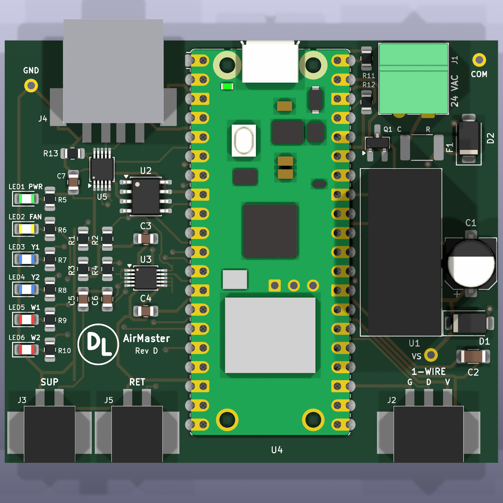
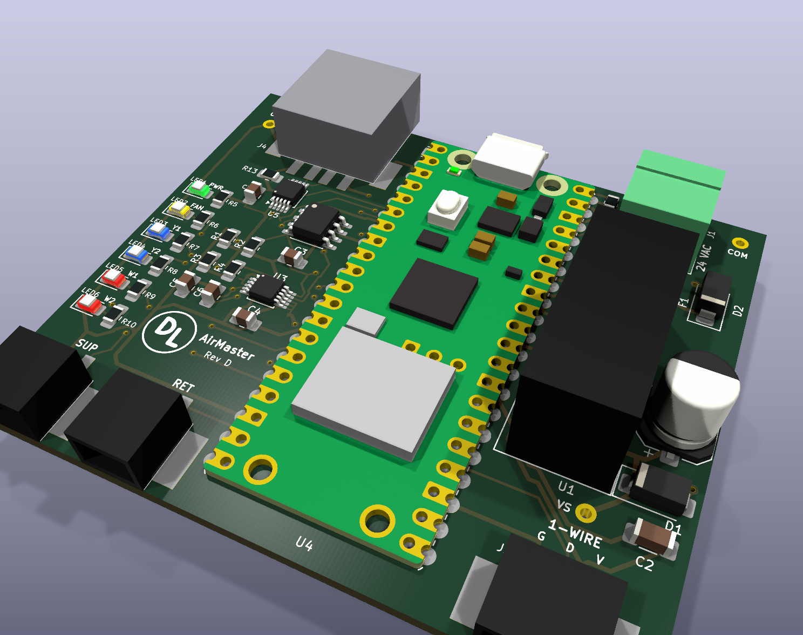
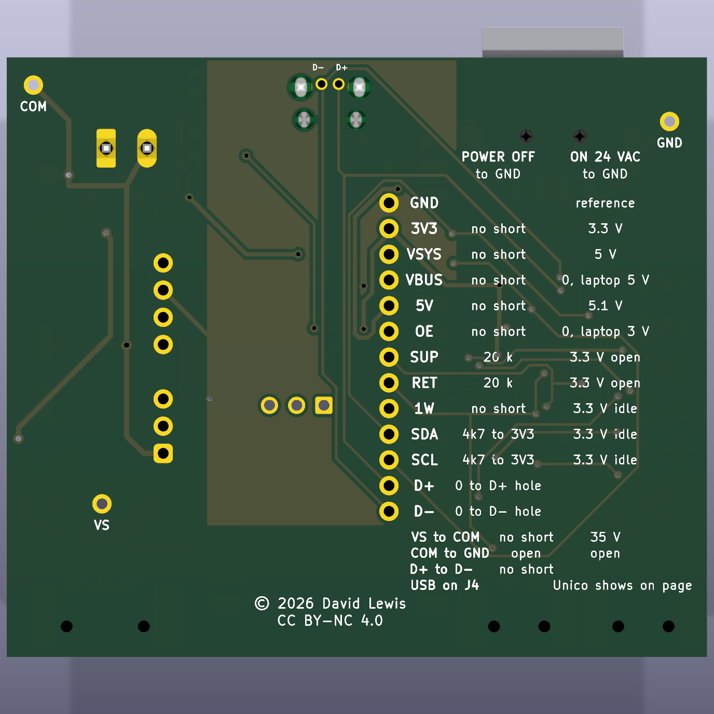
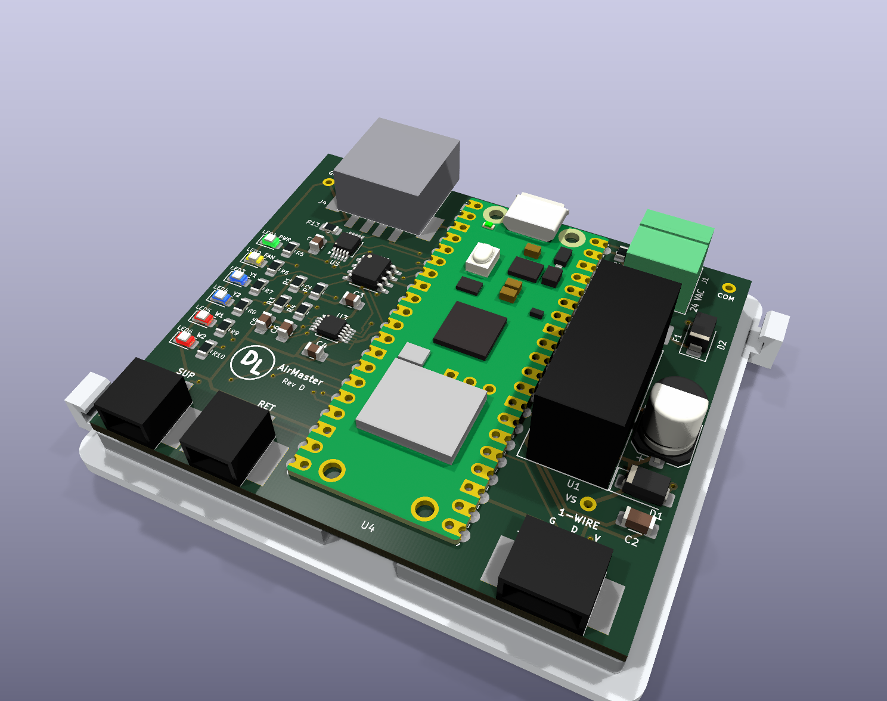
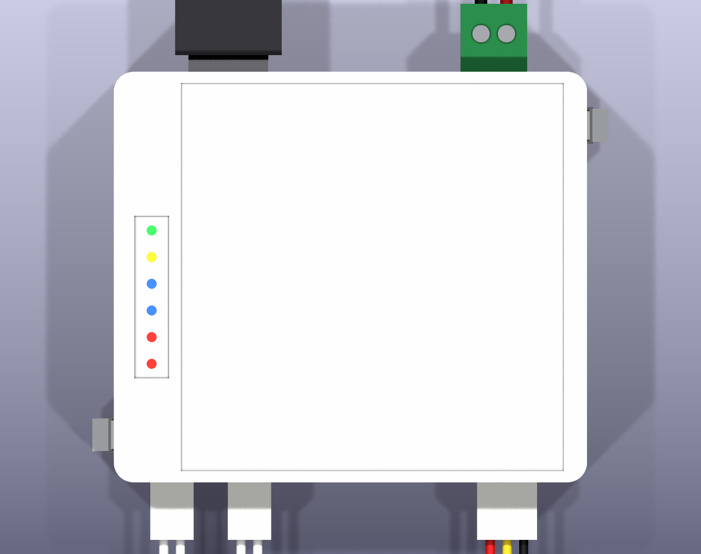
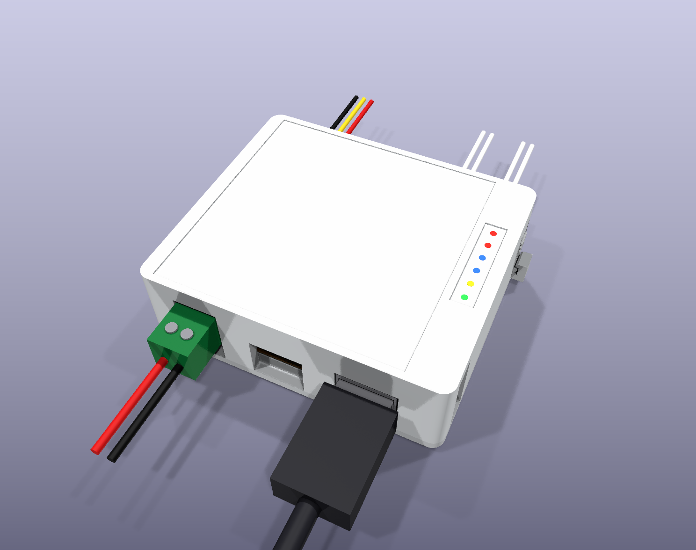
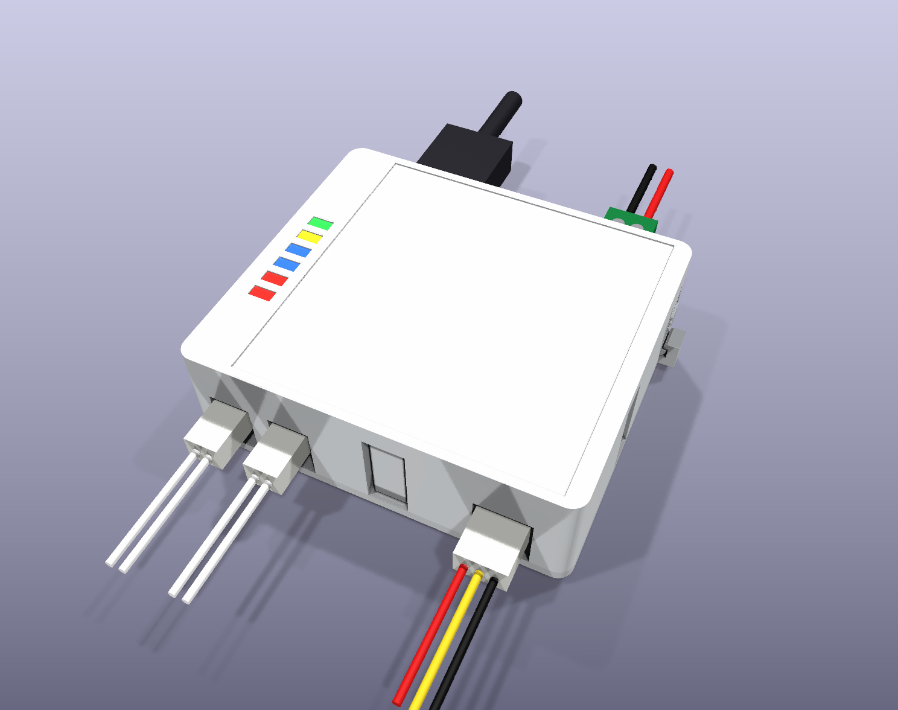

<!-- SPDX-License-Identifier: CC-BY-NC-4.0 -->
<!-- Copyright David Lewis -->
# AirMaster carrier Rev D and its printed case

Rev D is the AirMaster Pico W carrier laid out so that David can build it by hand or have JLCPCB assemble it, with a printed case that opens without tools. Every part is on the front and in JLCPCB's assembly stock, and the board has no mounting holes. The circuit and the Pico's pin assignments are Rev C's (`docs/airmaster/rev-a/air-handler-shield-pcb-plan.md` §0), so the `AirMaster` firmware runs on it unchanged. Nothing is ordered.

Three drawings carry the detail: `air-handler-pico-revd-board-front.svg` and `air-handler-pico-revd-board-back.svg` show the pads and every legend as the fabricator prints them, and `air-handler-pico-revd-case.svg` shows the case in plan, elevation and section with its label.

## How Rev D differs from Rev C

| Subject | Rev C | Rev D |
|---|---|---|
| Board | 56.4 × 56 mm | 65.4 × 56 mm |
| Mounting | 3 screws, 2 notches | none; the top's hooks hold it |
| Back | 18 parts | bare, with the checkout table |
| LEDs | back, through the floor | front, under light pipes |
| Test points | three loops | three loops and 13 holes |
| Air sensors | one 4-pin header | two 2-pin headers |
| USB-A jack | through-hole | surface-mount |
| U1 | TMR 3-4811WI | URB4805S-3WR3 |
| D1 | S1M | M7 |
| C2 | 10 µF | 100 µF 6.3 V |
| Box | Hammond 1593K, 2 screws | printed base and top, 2 latches |
| Label | 57 × 60 mm, notched | 56.8 × 57.6 mm rectangle |

## The board

`hardware/gen-ah-pico-d.py` generates it in `hardware/ahpd-board/`, and `sh hardware/ahpd-build.sh` routes it, checks it and exports the gerbers and JLCPCB's two files. The generator stops if any silkscreen legend touches a pad, a part's body, other text or the board's edge, or if any part has no visible reference. The finished board runs x 0.3–65.7, y 0–56. The top edge carries the USB-A jack, the Pico's micro-USB and the 24 VAC header. The bottom edge carries the two air-sensor headers on the left and the 1-wire header on the right, with the Pico's antenna between them.

| Ref | Part | LCSC |
|---|---|---|
| U4 | Raspberry Pi Pico W | C7203003 |
| U1 | URB4805S-3WR3 | C20198635 |
| U2 | DS2482S-100+ | C143306 |
| U3 | ADS1115IDGS | C37593 |
| U5 | FSUSB42MUX | C11355 |
| Q1 | DMG2305UX-7 | C150470 |
| J1 | Phoenix 1803277 | C480537 |
| J2 | Phoenix 1778777 | C3583902 |
| J3, J5 | Phoenix 1778764 | C5149246 |
| J4 | HRO U-A-24SS-W-1 | C283549 |
| F1 | 1812L020/60DR | C315900 |
| D1 | M7 | C95872 |
| D2 | SMAJ43CA | C223990 |
| C1 | 47 µF 50 V | C445256 |
| C2 | 100 µF 6.3 V 1206 | C15008 |
| C3–C7 | 100 nF 0805 | C49678 |
| R1, R2 | 4k7 0805 | C17673 |
| R3, R4 | 10k0 0.1 % 0805 | C110775 |
| R5–R10 | 220 Ω 0805 | C17557 |
| R11 | 100 k 0805 | C149504 |
| R12 | 22 k 0805 | C17560 |
| R13 | 33 k 0805 | C17633 |
| LED1 | green 0805 | C2297 |
| LED2 | yellow 0805 | C2296 |
| LED3, LED4 | blue 0805 | C2293 |
| LED5, LED6 | red 0805 | C84256 |

1. U4: the footprint is KiCad's hand-solder Pico W pattern with two plated holes, 0.7 mm in 1.1 mm pads, under the Pico's TP2 (D−) and TP3 (D+), as on Rev C. Fill both with solder from the back once the Pico is down, on a hand-built board and on an assembled one: the stencil puts no paste in a hole. The back marks them `D−` and `D+`. The paste layer opens each castellated pad over its own copper (`hardware/ahp-paste.py`).
2. U1: the footprint takes the URB4805S-3WR3 and the Traco TMR 3-4811WI. Both have the same pins at the same positions. The URB's body is 9.5 mm thick with its pin row 2.5 to 2.7 mm from the face nearest the Pico, so it reaches 1.4 mm further toward C1 than the Traco, and C1, D1 and C2 stand 0.7 mm clear of it. Pin 8 has a hole and no net: it is an internal node on the HI-LINK and YLPTEC parts. Pin 3, the remote input, is open, which runs every make. Murata's NCS3S4805SC (Digi-Key 811-3087-ND, $12.27, 1,079 in stock on 2026-11-16) has the same six pins at the same positions by JLCPCB's library footprint, 21.95 × 9.45 × 11.25 mm; check its pin row's distance from the body faces and its control pin against Murata's data sheet before fitting one.
3. U1: the URB needs a 30 mA load at 5 V for its ripple figure. The node draws about 90 mA with the Unico USB board (plan §0, bench results).
4. C2: HI-LINK's application circuit puts 100 µF on the output and Mornsun's 10 µF. 100 µF is inside the limit of each converter, the Traco's 1,680 µF included.
5. J3, J5: one 2-pin header for each air sensor, `SUP` then `RET`, beside U3 and its dividers. A 10K NTC has no polarity. The two plugs are alike, so mark them. JLCPCB had no stock of the 4-pin header, 1778780, on 2026-11-16.
6. J2: the 1-wire header, pins V, D, G from the right, on the right of the antenna.
7. U1, J1: through-hole, nine joints. JLCPCB solders them, or they take three minutes with the iron. The surface-mount converters of this rating (Traco TMR 3-4811WISM, TDN 3-4811WISM) cost $45 to $49 at JLCPCB against $3.59.
   J1: the 3.81 mm header of Rev B and Rev C, so the 24 VAC screw plug is unlike every other plug on the board and cannot enter a sensor header.
   J4: a surface-mount USB-A jack: four signal pads, a 2.2 × 5.0 mm shell pad each side and two plastic pegs in unplated 1.3 mm holes. Its face stands 2.8 mm past the board edge, flush with the outside of the top's wall, which keeps its pads clear of U5. Pads are from HRO's drawing and JLCPCB's footprint. HRO is sold by LCSC and JLCPCB only. For a hand build the Same Sky UJ2-AH-1-SMT-TR fits the same pads (Digi-Key 102-4133-1-ND, 16,550 in stock at $1.39; Mouser 490-UJ2-AH-1-SMT-TR, 17,067 at $1.39 plus tariff, both on 2026-11-23): its drawing gives pegs 5.00 mm apart in 1.30 mm holes, shell pads 2.15 × 4.80 mm centred 7.33 mm out, the signal row on the 2.5, 2.0, 2.5 mm pitch and the face 10.25 mm from the pegs against the footprint's 10.2 mm. The comparison is from the drawings; no UJ2 has been placed on a board. The Adam Tech USB-A-S-RA-TSMT and Samtec USB-A-S-x-x-SM2 take the same pads with the face 0.65 and 1.3 mm further in, and the Amphenol 87583 and Würth 629104190121 do not fit.
8. LED1–LED6: one column down the left strip at x 3.2, y 21 to 41, 4 mm apart, cathodes outboard on a ground bus that runs up to the GND test loop. Each LED's reference and its call (`LED3 Y1`) stand in the gap above it, and its resistor's reference beside the resistor.
9. U5, C7, R13: under the jack's pins, with U5's HSD1 pair going straight up into the jack's pins 2 and 3. Q1, R11 and R12 stand beside the Pico's VBUS and VSYS pins.
10. The licence legend is on the back under the Pico, since the sensor legends leave no room beside the title block. The title block reads `AirMaster` over `Rev D`, centred on the monogram.
11. R12 stands 2.4 mm below R11 so both references fit between them, and J1 to J5 each carry their reference beside their own pads.

The top's four pins meet the board at x 2.4, y 14.5; x 62.6, y 7.6; x 2.4, y 44.1; and x 49.5, y 42.0. The nearest pad to any of them is 0.95 mm away.

### Test points

`VS`, `COM` and `GND` keep their loops outside the Pico and are named on both faces. Thirteen more 1.0 mm holes stand in one column under the Pico at x 30, 2.4 mm apart, and are read from the back, where a table beside them gives each reading with the power off and on 24 VAC. With the top off its base the back of a live board faces the bench.

| Hole | Power off | On 24 VAC |
|---|---|---|
| `GND` | | reference |
| `3V3` | no short | 3.3 V |
| `VSYS` | no short | 5 V |
| `VBUS` | no short | 0 V; 5 V on a laptop |
| `5V` | no short | 5.1 V |
| `OE` | no short | 0 V; 3 V on a laptop |
| `SUP`, `RET` | 20 k | 3.3 V unplugged |
| `1W` | no short | 3.3 V idle |
| `SDA`, `SCL` | 4k7 to `3V3` | 3.3 V idle |
| `D+`, `D−` | 0 Ω to its filled hole | |

1. Every reading is to `GND` unless the row says otherwise. Below the column the table adds `VS` to `COM` (no short; 35 V), `COM` to `GND` (open both ways, the isolation across U1) and `D+` to `D−` (no short).
2. `D+`, `D−`: the column holes are the U5 end of the USB pair. Each beeps to its filled hole under the Pico's micro-USB, which proves the hole took solder and the track to U5 is whole. A micro-USB cable plugged into the Pico, beeped from its USB-A plug (pin 3 `D+`, pin 2 `D−`) to the column, also proves the joint to the Pico's pad.
3. `SDA`, `SCL`: 4k7 to `3V3` is R1 and R2; a bridge at U2 or U3 changes it.
4. The column cannot be reached from the front once the Pico is on.

## The case

`hardware/ahpd-case.py`, run with `freecadcmd`, writes the base and the top to `hardware/ahpd-case/` as STEP and STL, and the case drawing to this folder. Closed, the case is 71.0 × 61.6 × 22.1 mm, and 77.4 mm across its two lugs.

| Item | Value |
|---|---|
| Wall | 2.4 mm |
| Base plate, face | 2.0 mm |
| Board to wall | 0.4 mm |
| Under the board | 3.5 mm |
| Above the board | 13.0 mm |
| Base volume | 9.6 cm³ |
| Top volume | 17.7 cm³ |
| Label pocket | 57.4 × 58.2 × 0.3 mm |
| Light pipes | 6, Bivar PLPC2-500 |

1. The base is a plate that stays on the air handler, on VHB tape or on two #6 pan-head screws through its 4 × 10 mm slots, one slot along each axis. A rim 1.4 mm thick stands inside the top's walls and locates it.
2. The top carries the board. The board presses in from below, parts toward the face, against four pins, and three snap hooks catch its back: one in the left wall near the power end, one in the right wall at mid length and one at the sensor end under the antenna. Each hook bends 1.2 mm at 1.4 % strain.
3. Every connector stands in a notch in one of the top's end walls, open toward the base, so the top comes away with the board and its plugs.
4. Two latch tabs in the top's side walls, the left at the sensor end and the right at the power end, each carry a barb that sits under the lip of a lug on the base. Squeezing the two tabs across the diagonal moves the barbs clear and the top lifts off. Each tab bends 0.9 mm at 1.1 % strain. Three ribs mark where to press.
5. A block on the left of the top has a shaft over each LED. With the top face down on the bench a light pipe drops into each shaft, head toward the LED, and pressing the board in traps all six: each pipe stands between a 0.8 mm lip at the face, with a 1.5 mm window through it, and its LED, with 0.4 mm of play. The shafts print at 2.7 mm and need no drilling, press fit or glue. A strip of the face over the column is sunk 0.2 mm to put the lip at that height. With no pipe fitted a shaft is an open hole over its LED.
6. The pipes fall out when the board comes out, unless the top is face down.
7. One pocket in the face takes the printed label, a 56.8 × 57.6 mm rectangle: each port named at its notch with its pin letters at their true positions, the LED names down the left edge beside the windows, the blue monogram with `AirMaster` and "for the Unico SMART controller", and the QR code beside the WiFi name, password and serial number. Nothing is cut into the face. `Arduino AirMaster/factory/label.py` still prints the Rev C label; the case drawing shows the Rev D layout with sample values.
8. No wall in either part is under 0.8 mm, JLC3DP's limit for SLS. Print the base plate down and the top face down. In MJF or SLS nylon neither needs support, and nylon suits the hooks and latches. The printer is JLC3DP, SLS in 1172Pro, their white unfilled PA12, about $9 a case in a lot of five (quoted 2026-11-16 for the earlier two-part case, 30 cm³ against this one's 27 cm³), with no dye or polish. The fits are sized for SLS nylon 12 limits of ±0.38 mm on a dimension: 0.3 mm between the top and the rim, 0.8 mm slits round the hooks and tabs, and the pipe's play stays between 0.1 and 0.7 mm.
9. The script checks 34 part, plug and screw-head bodies against both halves and stops if any shares volume with either, and checks each light pipe for clearance in its shaft and play over its LED.

| | Digi-Key | Mouser |
|---|---|---|
| Bivar PLPC2-500 | 492-1993-ND | 749-PLPC2500 |
| Stock, 2026-11-22 | 12,224 | 8,648 |
| Each at 1 / 10 / 100 | $1.54 / $1.09 / $0.82 | $1.54 / $1.09 / $0.82 |

The pipe is clear polycarbonate, 12.7 mm long, with a 1.9 mm body and a 2.3 mm head. Mouser adds a 15 % tariff. Industrial Fiber Optics IF-C-U2000 (Digi-Key FB198-ND, $5.86 a metre), a 2.0 mm PMMA fibre cut to 12.7 mm, is the cheaper stand-in at about $0.45 a unit.

`sh hardware/ahpd-render.sh docs/airmaster/rev-d` renders the board and the case, and `hardware/ahpd-svg.py`, run with KiCad's Python, draws the two board faces.

## Ordering from JLCPCB

| JLCPCB asks for | File in `hardware/ahpd-board/` |
|---|---|
| Gerbers | `ahpd-board-gerbers.zip` |
| BOM | `ahpd-board-jlc-bom.csv` |
| CPL | `ahpd-board-jlc-cpl.csv` |

The assembly is one side: 40 parts on 26 BOM lines, 148 surface-mount joints and nine through-hole joints on U1 and J1. Eleven lines are basic parts and fifteen extended. The parts cost $27.99 a board, of which the Pico W is $12.84. Stock and prices are JLCPCB's of 2026-11-16.

Estimate for five boards on the Economic service, from JLCPCB's published fees:

| Item | USD |
|---|---|
| Parts | 140 |
| Extended parts, 15 at $3 | 45 |
| Setup and stencil, one side | 10 |
| Placement, 150 joints a board | 1 |
| Bare boards | 5–10 |
| Total | about 205 |

Through-hole soldering of U1 and J1 (about $4 an order by JLCPCB's FAQ), shipping and duty are extra. The upload shows whether the Economic service takes the Pico W and the headers; the Standard service adds about $58 at its two-sided rate. The case is about $9 from JLC3DP (the case section, note 8).

## To check before ordering

1. Rotations. The placement file carries KiCad's angles. Check U4, U1, U2, U3, U5, Q1, C1, D1, D2 and the six LEDs in JLCPCB's placement preview.
2. The URB4805S-3WR3 on the bench: start-up on the half-wave rail, whose valley is about 27 V, and ripple at the node's load.
3. RSSI in the closed printed case, against the Rev B figure in the Hammond box.
4. The LED windows on the first print: brightness and bleed into the neighbouring window with a Bivar pipe, with a cut fibre and with the shaft open.
5. The fit of the first print: the board under its three hooks, each plug through its notch, the latch tabs on their lugs, and a pipe's play in its shaft.
6. The headers. The five Phoenix 1808190 headers in stock have not been compared with the 1778764 footprint of J3 and J5.
7. U1's alternatives. The Mean Well SPBW03G-05 body is not in the case's fit check.
