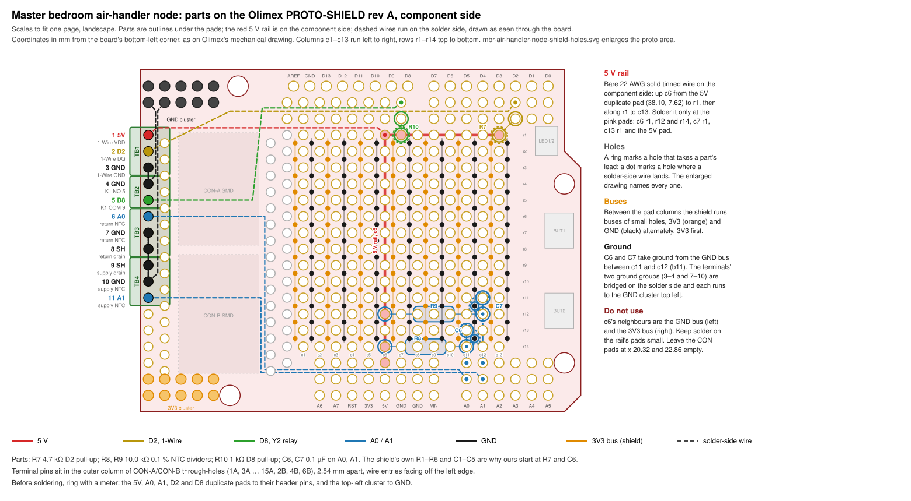

# Master bedroom air-handler node: PROTO-SHIELD layout

This is the parts layout for the Olimex PROTO-SHIELD rev A on the master bedroom air-handler node. The circuit is in `mbr-air-handler-node-plan.md` §3; this file places it on the board. Eleven screw terminals sit along the left edge, the six small parts sit on the prototyping area, and a bare wire adds the 5 V rail the shield lacks. The drawing is generated by `mbr-air-handler-node-shield-layout.gen.py`.

## The board

The geometry comes from Olimex's PROTO-SHIELD user manual (June 2011): the rev A schematic on page 3, the photograph on page 4 and the mechanical drawing on page 9. Coordinates are in millimetres from the bottom-left corner, as on that drawing, with the DIGITAL header along the top.

| Feature | Location |
|---|---|
| Proto pads c1–c13 | x 25.40 to 55.88 |
| Proto rows r1–r14 | y 43.18 to 10.16 |
| Bus holes b0–b13 | x 24.13 to 57.15 |
| GND cluster, 10 pads | top left, y 48.26 and 50.80 |
| 3V3 cluster, 10 pads | bottom left, y 2.54 and 5.08 |
| CON through-holes | x 1.28 and 3.82 |
| Header duplicates | two pads per pin |

1. The proto pads sit on a 2.54 mm grid and connect to nothing.
2. Between each pair of pad columns the shield runs a bus of small holes, half a pitch off in both directions. The buses alternate 3V3 and GND, 3V3 first: b0 at x 24.13 is 3V3, b1 at 26.67 is GND, and so on. The odd-numbered buses are ground.
3. The 30 CON-A and CON-B through-holes on the left edge are staggered 1.27 mm apart between the two columns. Each column on its own is a 2.54 mm row. Every hole is wired only to its own surface-mount pad, so with nothing on those pads each hole is an isolated land.
4. Each header pin has two duplicate pads on the grid beside it. On the DIGITAL header they are at y 48.26 and 45.72. On the POWER and ANALOG headers they are at y 5.08 and 7.62. The D8–AREF duplicates sit 1.02 mm left of their pins, where a trace jogs them onto the grid.
5. The shield has no 5 V bus. Its 5 V reaches only the POWER header pin and that pin's two duplicate pads.

## The 5 V rail

The rail is a length of bare 22 AWG solid tinned copper laid on the component side, about 55 mm in all. It starts at the 5V duplicate pad at (38.10, 7.62) and runs up column c6 to r1. From there it turns right along r1 to c13. Column c6 stands directly above the 5V pin, so the rail starts at the pin with no jumper. The branch along r1 runs under the D8 and D2 duplicate pads, so both pull-ups stand between the rail and their pins with no wire at all.

Solder the rail only where a lead lands: c6 at r1, r12 and r14, c7 r1 and c13 r1, plus the 5V pad at its foot. Column c6 lies between the GND bus b5 and the 3V3 bus b6, whose holes are 1.8 mm from each c6 pad centre, so keep every joint on the rail small. The node draws a few milliamps from this rail. Belden 8021 is the bus wire in the parts list, but 100 ft costs about $97, so 6 cm stripped from any 22 AWG solid hook-up wire serves as well.

## Parts

| Ref | Value | From | To |
|---|---|---|---|
| R7 | 4.7 kΩ | c13 r1 | D2 pad, 45.72 |
| R8 | 10.0 kΩ | c6 r14 | c11 r14 |
| R9 | 10.0 kΩ | c6 r12 | c12 r12 |
| R10 | 1 kΩ | c7 r1 | D8 pad, 45.72 |
| C6 | 0.1 µF | c11 r13 | b11, y 11.43 |
| C7 | 0.1 µF | c12 r11 | b11, y 16.51 |

1. R7 and R10 stand on end. The body sits over the rail pad and the top lead bends over to the duplicate pad 2.54 mm above (R10) or 3.6 mm up and to the right (R7).
2. R8 and R9 lie flat along their rows, at 12.70 mm and 15.24 mm lead spacing.
3. C6 and C7 stand up. Their ground leads go into the GND bus b11, which runs between the A0 column (c11) and the A1 column (c12), so both capacitors ground within 2 mm of their pins. C7 sits four rows above C6 so the two bodies clear each other.
4. Olimex publishes no drill size for the bus holes. If a capacitor lead will not pass, lay it across the hole's ring on the component side and solder it there.
5. The shield's own parts are R1–R6 and C1–C5, which is why this build's numbers start at R7 and C6.

## Terminals

The terminal pins sit in the outer CON column at x 1.28, at holes 1A, 3A … 15A, 2B, 4B and 6B. The wire entries face off the left edge. Position 1 is at the top, y 43.18, and position 11 is at y 17.78.

| Pos | Block | Net | Field side |
|---|---|---|---|
| 1 | TB1 | 5V | XT1 |
| 2 | TB1 | D2 | XT2 |
| 3 | TB1 | GND | XT3 |
| 4 | TB2 | GND | K1 NO 5 |
| 5 | TB2 | D8 | K1 COM 9 |
| 6 | TB3 | A0 | XT4 |
| 7 | TB3 | GND | XT5 |
| 8 | TB3 | SH | XT6 |
| 9 | TB4 | SH | XT9 |
| 10 | TB4 | GND | XT8 |
| 11 | TB4 | A1 | XT7 |

1. The order puts the six ground terminals in two adjacent runs, 3–4 and 7–10. Each run is bridged on the solder side and joined to ground by one wire.
2. The supply-air set is mirrored (SH, GND, A1) so that its drain sits beside the return-air drain.
3. The digital terminals are at the top, near the DIGITAL header, and the analog ones lower down, near the ANALOG header.
4. If the blocks on hand are two 6-way blocks, position 12 at y 15.24 is a spare.

## Solder-side wiring

Insulated 22 AWG on the solder side, drawn dashed on the drawing.

| From | To | Net |
|---|---|---|
| Pos 1 | c6 r1 | 5V |
| Pos 2 | D2 pad, 48.26 | D2 |
| Pos 3–4 | GND cluster, x 1.28 | GND |
| Pos 5 | D8 pad, 48.26 | D8 |
| Pos 6 | A0 pad, 5.08 | A0 |
| Pos 7–10 | GND cluster, x 3.82 | GND |
| Pos 11 | A1 pad, 5.08 | A1 |
| c11 r13–r14 | A0 pad, 7.62 | A0 |
| c12 r11–r14 | A1 pad, 7.62 | A1 |

1. The terminal wires take the outer duplicate pads and the parts take the inner ones, so no hole carries two conductors.
2. The last two rows are lead tails: bend R8's and C6's tails along c11 to the A0 pad, and R9's and C7's along c12 to the A1 pad.
3. The bridges on positions 3–4 and 7–10 are bare wire across the terminal pins.

## Pins left alone

Y2 is on D8 because the shield already uses D6. Its BUT1 button, a 4.7 kΩ pull-up to 3.3 V and a 100 nF capacitor reach D6 through the closed solder jumper B1_E. Next to a 1 kΩ pull-up to 5 V, that pull-up to 3.3 V would feed a third of a milliamp into the 3.3 V rail. D8 has nothing of the shield's on it. D3, kept for a flow meter, carries LED1 through the closed jumper L1_E, so cut L1_E when the meter is wired.

## Order of work

1. Set the shield on the R4 dry and look at the left edge. The R4's USB-C and barrel jack sit under it, and the terminal row ends 17.8 mm above the bottom edge to clear the jack. Check that a block body set in the outer column leaves its wire entries at the board edge. If it would overhang the edge by more than 2 mm, move the row to the inner column.
2. Ring with a meter, off the R4: the 5V, A0, A1, D2 and D8 duplicate pads to their header pins, the top-left cluster to a GND pin, and b11 to GND.
3. Solder the stacking headers.
4. Solder the terminal blocks. Trim their pins flush on the solder side.
5. Lay and solder the 5 V rail.
6. Fit R8, R9, C6 and C7, then R7 and R10.
7. Run the solder-side wires and the two ground bridges.
8. Meter, still off the R4: 5V to GND and 5V to 3V3 open, each signal pin to its terminal closed, each ground terminal to the GND cluster closed.
9. Cover the solder side under the terminal row with polyimide tape, then fit the shield.
