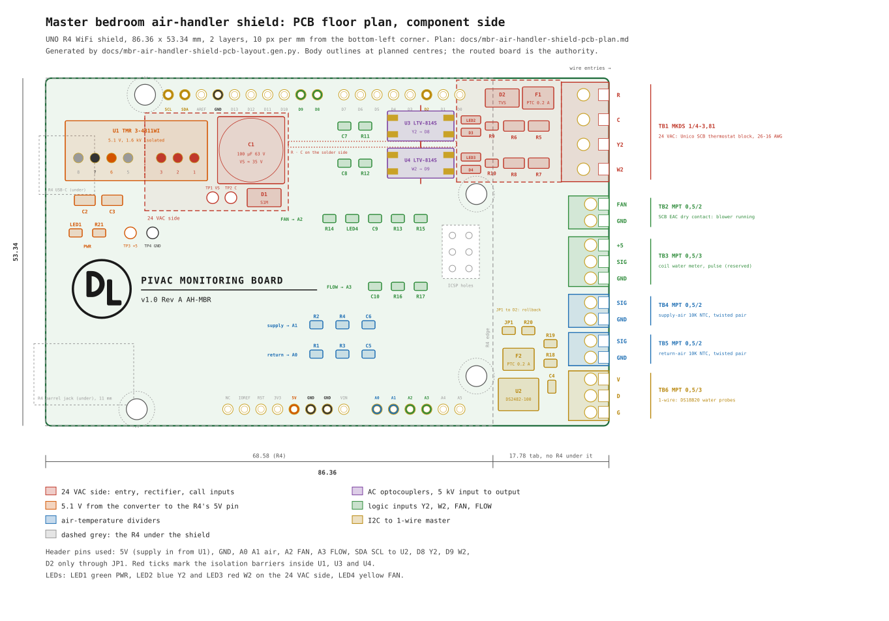

# Master bedroom air-handler shield: PCB plan

**Status:** Plan and floor plan drawn; no board generated yet. · **Owner:** David

The master bedroom node is an Arduino UNO R4 WiFi with a hand-wired Olimex PROTO-SHIELD, a DIN-rail 24 VAC to
USB-C buck converter, a Magnecraft 792 relay on a socket and nine feed-through blocks
(`docs/mbr-air-handler-node-plan.md`, `docs/mbr-air-handler-node-shield-review.md`). This board replaces the
proto-shield, the converter and the relay with one fabricated shield. The field wiring lands on screw terminals along
one short edge. The 24 VAC is converted on the board through an isolated converter, as on the pivac EXT board. The
DS18B20 water probes run from a DS2482 I2C master, as on EXT, and the Y2 relay sits on the board. The board adds a
W2 relay and an input for the blower-running contact. Everything else on it is surface-mount, apart from the
terminals, the converter and the Arduino headers. `docs/mbr-air-handler-shield-pcb-layout.svg` is the floor plan,
generated by `docs/mbr-air-handler-shield-pcb-layout.gen.py`.

## 1. Scope

**In scope.** One two-layer shield for the UNO R4 WiFi carrying the 24 VAC entry, the rectifier and an isolated
24 VAC to 5.1 V converter feeding the R4's 5V header pin, two relays for Y2 and W2, a dry-contact input for the
Unico's blower-running contact, a pulse input reserved for a coil water meter, the two air-temperature dividers, a
DS2482-100 driving the 1-wire bus, status LEDs, test pads and the title block. The generator, the routing and the
gerbers follow the EXT board's toolchain in `hardware/`.

**Out of scope.** The probes, the NTC sensors and their mounting stay as `docs/mbr-air-handler-node-plan.md` §3
specifies them. The water meter itself is not chosen. No change to the Unico controller's settings.

**Boundaries assumed.**

- "Two air flow sensors" means the two 10K NTC air-temperature sensors in the supply and return plenums, which the
  node plan already specifies. A true airflow sensor needs a different front end and a different terminal.
- The field cables can land on the shield directly, so the QUATTRO feed-through blocks become optional. The 24 VAC
  terminals take 18 AWG thermostat wire; the sensor terminals take up to 20 AWG.
- The Arduino header holes take plain male headers or stacking headers, decided at assembly.
- Nothing is stacked above this shield in service (§8, item 9).

## 2. Signals at the Unico thermostat block

The Unico Smart Control Board's thermostat block (Bulletin 30-39, Table 5) has these inputs, all 24 VAC from R:

| Terminal | Call | On this board |
|---|---|---|
| R, C | 24 VAC supply | power entry |
| Y1 | cool, low fan | no |
| Y2 | cool, high fan | relay K1 |
| W1 | heat, low fan | no |
| W2/S1 | heat, high fan | relay K2 |
| G | fan only | no |
| O-b | reversing valve | no |
| E, W3, S3 | emergency and electric heat | no |

1. **W2.** The thermostats are two-stage in heat and cool, and stage 2 is the air handler's high fan, so W2 is the
   heating twin of Y2. Through the winter, with the Chiltrix on in heat mode, the question the node exists to answer
   (was the coil already on high fan when the room lost ground?) is a W2 question. Add it.
2. **Y1, W1, G.** RedLink reports the first-stage calls and the fan-only state, and `HPCALL` confirms the hydronic
   call at the panel. A relay here would duplicate them.
3. **O-b.** The `HPHEAT` and `HPCOOL` relays already report the system's mode.
4. **E, W3, S3.** No electric heat is fitted.

The accessories block offers one signal the thermostat side cannot: the EAC contact (Table 7), a dry relay contact
that closes whenever the blower runs on high or low. It proves the blower ran, which separates a dead motor from a
coil that is short of water. It needs no relay, because it is already a dry contact. The board reads it on TB2 if
the EAC terminals are unused. Check that before wiring it: Diagram 12 shows the EAC contact switching 120 V or
24 V to an air cleaner when one is fitted.

## 3. Board and terminal edge

The shield is 86.36 × 53.34 mm. It follows the R4's outline for 68.58 mm and continues 17.78 mm past the R4's right
edge as a tab with nothing under it. The terminals stand on that tab with their wire entries facing right. Inside
the R4's outline the right edge is blocked: the ICSP header stands 8.5 mm tall at mid-height, and the header rows
reach the corners. The edge inside the outline would take eleven 2.54 mm positions at most, against the sixteen this
board needs, and their pins would land over the R4's parts.

| Ref | Part | Positions |
|---|---|---|
| TB1 | Phoenix MKDS 1/4-3,81 | R · C · Y2 · W2 |
| TB2 | Phoenix MPT 0,5/2-2,54 | FAN · GND |
| TB3 | Phoenix MPT 0,5/3-2,54 | +5 · SIG · GND |
| TB4 | Phoenix MPT 0,5/3-2,54 | SIG · GND · SH |
| TB5 | Phoenix MPT 0,5/3-2,54 | SIG · GND · SH |
| TB6 | Phoenix MPT 0,5/3-2,54 | V · D · G |

1. TB1 is the 24 VAC group, at the top of the edge, 3.81 mm pitch, 26–16 AWG. An 18 AWG thermostat conductor fits
   it and will not enter the 2.54 mm terminals below, so the AC wires cannot be landed on a sensor terminal.
2. TB2 is the blower-running contact from the Unico's EAC terminals.
3. TB3 is the coil water meter, reserved (§4.7).
4. TB4 is the supply-air NTC and TB5 the return-air NTC, each on its own Belden 8451 pair. SH takes the drain and
   joins GND on the board; cut the drain back at the sensor end.
5. TB6 is the 1-wire bus to the two DS18B20 water probes, in the V · D · G order of the EXT board's legend.
6. The MPT terminals take 26–20 AWG. The blocks are fixed screw terminals, so the plug mix-ups recorded on the EXT
   board (rev C plan §4.1) cannot happen here.
7. All six blocks are through-hole. A screw terminal takes torque at every landing, and through-hole pins hold it.
   The four mounting holes on the UNO pattern take M3 standoffs to the R4; fit the two right-hand standoffs before
   landing wires, because they carry the tab.

## 4. Circuit

### 4.1 24 VAC entry and converter

R enters on TB1.1 through F1, a 0.2 A PTC, and D2, a 43 V bidirectional TVS, clamps R to C after the fuse. D1, one
S1M diode, rectifies half-wave into C1, 100 µF 63 V, which makes VS at about 35 V against C. U1, a Traco
TMR 3-4811WI, takes VS and returns 5.1 V ±1 % across its 1.6 kV isolation barrier.

The EXT board uses a full bridge. This board uses half-wave rectification, which makes C the one reference for the
whole 24 VAC side: the relay coils, VS and the test pad all return to the transformer's C. The board draws about
60 mA at VS, which a single diode carries easily. C1's ripple at that current is 10 V peak to peak, and the valley
at a low line of 21.6 VAC is 19.6 V, above U1's 18 V minimum. A WiFi transmit burst lasts milliseconds, and
C1 rides through it.

U1 is the same family as the EXT board's converter at a quarter of the power. The R4 WiFi draws 0.1–0.45 A at 5 V,
and the TMR 3 delivers 0.6 A. The footprint takes either the TMR 3-4811WI or one of the two TMR 12-4811WI on hand.
Their single-output pins share positions 1, 2, 3, 6, 7 and 8, and the TMR 3's pin 5 has a hole with no copper. The
on-hand pair stays reserved for EXT boards, so buy a TMR 3 for this one.

### 4.2 Feeding the R4

U1's output feeds the R4's 5V header pin directly. The R4 brings USB-C power in through a Schottky diode, which is
why the USB-C feed in PR #240 measured 4.65 V. The header pin gives the full 5.1 V, which is inside the RA4M1's
5.5 V limit and lifts the NTC dividers' reference.

1. **Regulation.** U1 regulates to ±1 % at any line or load the board presents. The R4's own buck sits idle, because
   VIN carries nothing.
2. **Laptop on USB-C while 24 VAC is live.** The same Schottky diode blocks the 5.1 V rail from back-feeding the
   laptop. U1's isolation keeps the laptop's ground off the transformer.
3. **What the header pin gives up.** The pin bypasses the R4's reverse-polarity diode. On a fixed copper trace the
   polarity cannot be reversed, so this costs nothing here.
4. **No USB-C pigtail.** The board has no pigtail socket.

### 4.3 Y2 and W2 relays

K1 (Y2) and K2 (W2) are Omron G6K-2F-Y DC24 relays: surface-mount, DPDT, 10 × 6.5 × 5.2 mm, with bifurcated
gold-alloy contacts made for signal loads. Each coil is driven from its call through a half-wave circuit referenced
to C:

| Ref (K1 / K2) | Part | Job |
|---|---|---|
| D3 / D5 | 1N4148W | rectifies the call |
| C7 / C8 | 10 µF 50 V X7R 1210 | holds the coil between half-cycles |
| R5 / R6 | 2.0 kΩ 0805 | drops the excess voltage |
| D4 / D6 | 1N4148W | flyback across the coil |

1. The coil is 5,220 Ω and must operate at 19.2 V. At 25.9 VAC the filtered call is about 35 V, and the coil sees
   25 V through R5. At 21.6 VAC it sees 20.9 V and still operates. At 28 VAC it sees 27.5 V, under the 36 V maximum.
2. Once operated, the relay holds down to 2.4 V, so C7's ripple cannot make it chatter. After the call ends, C7
   discharges through the coil and the relay releases within about 60 ms.
3. Each call draws about 5 mA from the thermostat output. The SCB input already loads the same terminal.
4. Both poles of each relay are paralleled between the input net and GND. R7 and R8 pull D8 and D9 up to 5 V
   through 1 kΩ. LED2 and LED3 light through 1 kΩ when the contacts close, so each contact carries 8 mA. The old
   792's concern about oxide film on silver contacts at 5 mA does not apply to these gold-alloy contacts.
5. The relay holds 1.5 kVAC between coil and contacts, which is the isolation between the call wiring and the R4.

### 4.4 Blower-running input

TB2 takes the EAC contact. R11 pulls the net up to 5 V through 1 kΩ, and LED4 lights through R12 when the contact
closes. R13 (1 kΩ) and C9 (10 nF) filter the net into A2. The net is a field wire, so the series resistor limits
the current into the pin if anything foreign lands on it.

### 4.5 Air temperatures

R1 and R2 are 10.0 kΩ 0.1 % 25 ppm thin-film 0805s from 5 V to each SIG terminal, with the NTC from SIG to GND.
R3 and R4 (1 kΩ) run from each divider node to A0 and A1, and C5 and C6 (100 nF) sit at the pins. No DC flows
through R3 or R4, so they add no error. The sketch's conversion in node plan §4.5 is unchanged, since the divider
and the ADC reference share the 5 V rail.

### 4.6 1-wire

U2 is a DS2482-100 at address 0x18 (AD0 and AD1 to GND, SLPZ to 5 V), running at 5 V on the R4's SDA and SCL pins,
which are A4 and A5. R16 and R17 (4.7 kΩ) pull SDA and SCL up through solder jumpers JP2 and JP3, closed as
built. U2's IO drives TB6.D and supplies the bus pull-up itself. TB6.V comes from 5 V through F2, a second 0.2 A
PTC, so a shorted probe cable trips F2 before it drops the R4's rail. C4 decouples U2.

JP1 is the rollback, open as built. Closed, it joins the bus to D2, and R18 (4.7 kΩ, not fitted) becomes the
bit-banged pull-up the present sketch uses. Leave U2 off the board while running that way.

### 4.7 Coil water meter (reserved)

TB3 carries 5 V, SIG and GND for a pulse meter. R14 (10 kΩ) pulls SIG up, and R15 (100 Ω) with C10 (1 nF) feeds A3,
which can raise an interrupt on the R4. Fit the three parts when a meter is chosen (Appendix E.6 of the cooling
assessment).

### 4.8 Pin map

| R4 pin | Net |
|---|---|
| 5V | U1 output |
| GND | ground |
| A0 | return air |
| A1 | supply air |
| A2 | FAN |
| A3 | FLOW |
| A4 / SDA | U2 SDA |
| A5 / SCL | U2 SCL |
| D8 | Y2 |
| D9 | W2 |
| D2 | JP1 only |

1. D8 keeps the Y2 pin the present sketch reads.
2. D0 and D1 (serial), D4 and D5 (CAN) and D10 to D13 (SPI) stay unused. The ICSP header passes through six
   clearance holes with no copper.
3. A2 and A3 replace the plan's D3 for the flow meter, because the converter stands under D3 to D7 and would force
   their tracks under its body, which Traco tells layouts to avoid.

## 5. Layout

The floor plan places the parts in four groups. The 24 VAC side runs along the top: the entry chain (F1, D1, D2,
C1) on the tab beside TB1, U1 under the digital header with its input pins at the right, and the relay coils with
their drive below K1 and K2. A dashed outline on the drawing marks it. The R · C · Y2 · W2 bus runs on the solder
side along y 33–34, and U1's 5.1 V output crosses it on the component side. The relay contacts face up to D8 and
D9. The logic inputs, the PWR LED and the test pads for +5 and GND sit at the left, over the R4's USB-C. The air
dividers stand above A0 and A1, and the DS2482 group sits on the tab beside TB6.

| Ref | Part | Centre (x, y) |
|---|---|---|
| U1 | TMR 3-4811WI, SIP-8 | body 44.5–66.3, 38.8–48.0 |
| C1 | 100 µF 63 V, 10 × 10.2 | 73.8, 41.8 |
| F1, D1, D2 | entry | 76.2 / 70.6 / 69.6, 48.5–51.4 |
| K1, K2 | G6K-2F-Y DC24 | 26.0 / 36.0, 43.6 |
| U2 | DS2482-100, SOIC-8 | 72.8, 8.0 |
| R1–R6, C5, C6 | air dividers | 49.0 and 54.0, 9–17 |
| TP1, TP2 | VS, C | 44.4 / 47.6, 33.4 |
| TP3, TP4 | +5, GND | 13.6 / 17.2, 36.4 |

1. The barrel jack under the bottom-left corner stands 11 mm, and the shield rests on it. Nothing through-hole goes
   there, and polyimide tape goes on the shield's underside over it. The title block takes that area.
2. U1 needs a rule area with no copper under its body (Traco's datasheet), as on EXT rev C.
3. The test pads follow EXT rev C §9: VS against C, +5 against GND, and C against GND open for the isolation check.
   They all sit on the component side, so the board proves itself before the R4 goes on.
4. The pin-1 legends, the TB labels and the `24VAC input` legend at TB1 follow the EXT boards' conventions.

## 6. Parts

Digi-Key refused automated page loads on 2026-10-19 (HTTP 403), so stock, price and Active status are unconfirmed.
Open each page before ordering. Every part except U1, the terminals and the headers is surface-mount on this board's
own pads; none needs a breakout adapter.

| Ref | Part | Qty | Digi-Key | Amazon |
|---|---|---|---|---|
| U1 | Traco TMR 3-4811WI | 1 | [search](https://www.digikey.com/en/products/result?keywords=TMR%203-4811WI) | [search](https://www.amazon.com/s?k=Traco+TMR+3-4811WI) |
| U2 | Analog Devices DS2482-100S+ | 1 | [search](https://www.digikey.com/en/products/result?keywords=DS2482-100S%2B) | [search](https://www.amazon.com/s?k=DS2482-100) |
| K1, K2 | Omron G6K-2F-Y DC24 | 2 | [search](https://www.digikey.com/en/products/result?keywords=G6K-2F-Y%20DC24) | [search](https://www.amazon.com/s?k=Omron+G6K-2F-Y+DC24) |
| F1, F2 | Bourns MF-MSMF020/60-2 | 2 | [3438084](https://www.digikey.com/en/products/detail/bourns-inc/MF-MSMF020-60-2/3438084) | [search](https://www.amazon.com/s?k=MF-MSMF020%2F60-2) |
| D1 | onsemi S1M | 1 | [search](https://www.digikey.com/en/products/result?keywords=S1M%20onsemi) | [search](https://www.amazon.com/s?k=S1M+SMA+diode) |
| D2 | Littelfuse SMAJ43CA | 1 | [search](https://www.digikey.com/en/products/result?keywords=SMAJ43CA) | [search](https://www.amazon.com/s?k=SMAJ43CA) |
| D3–D6 | Diodes 1N4148W-7-F | 4 | [search](https://www.digikey.com/en/products/result?keywords=1N4148W-7-F) | [search](https://www.amazon.com/s?k=1N4148W+SOD-123) |
| C1 | Panasonic EEE-FK1J101P | 1 | [search](https://www.digikey.com/en/products/result?keywords=EEE-FK1J101P) | [search](https://www.amazon.com/s?k=100uF+63V+SMD+aluminum+electrolytic) |
| C2 | Murata GRM31CR71A106KA01L | 1 | [search](https://www.digikey.com/en/products/result?keywords=GRM31CR71A106KA01L) | [search](https://www.amazon.com/s?k=10uF+10V+1206+X7R) |
| C3 | 22 µF 10 V X5R 1206 | 1 | [search](https://www.digikey.com/en/products/result?keywords=22uF%2010V%201206%20X5R) | [search](https://www.amazon.com/s?k=22uF+10V+1206) |
| C7, C8 | Murata GRM32ER71H106KA12L | 2 | [search](https://www.digikey.com/en/products/result?keywords=GRM32ER71H106KA12L) | [search](https://www.amazon.com/s?k=10uF+50V+1210+X7R) |
| C4–C6 | Yageo CC0805KRX7R9BB104 | 3 | [search](https://www.digikey.com/en/products/result?keywords=CC0805KRX7R9BB104) | [search](https://www.amazon.com/s?k=100nF+0805+X7R) |
| C9, C10 | 10 nF and 1 nF C0G 0805 | 2 | [search](https://www.digikey.com/en/products/result?keywords=0805%20C0G%2010nF) | [search](https://www.amazon.com/s?k=0805+C0G+capacitor+kit) |
| R1, R2 | Yageo RT0805BRD0710KL | 2 | [search](https://www.digikey.com/en/products/result?keywords=RT0805BRD0710KL) | [search](https://www.amazon.com/s?k=10k+0.1%25+0805+25ppm) |
| R3, R4, R7–R13, R19 | Yageo RC0805FR-071KL | 10 | [search](https://www.digikey.com/en/products/result?keywords=RC0805FR-071KL) | [search](https://www.amazon.com/s?k=0805+resistor+kit) |
| R5, R6 | Yageo RC0805FR-072KL | 2 | [search](https://www.digikey.com/en/products/result?keywords=RC0805FR-072KL) | in the kit |
| R14 | Yageo RC0805FR-0710KL | 1 | [search](https://www.digikey.com/en/products/result?keywords=RC0805FR-0710KL) | in the kit |
| R15 | Yageo RC0805FR-07100RL | 1 | [search](https://www.digikey.com/en/products/result?keywords=RC0805FR-07100RL) | in the kit |
| R16–R18 | Yageo RC0805FR-074K7L | 3 | [search](https://www.digikey.com/en/products/result?keywords=RC0805FR-074K7L) | in the kit |
| LED1 | Lite-On LTST-C171GKT, green | 1 | [search](https://www.digikey.com/en/products/result?keywords=LTST-C171GKT) | [search](https://www.amazon.com/s?k=0805+LED+green) |
| LED2–LED4 | Lite-On LTST-C171AKT, amber | 3 | [search](https://www.digikey.com/en/products/result?keywords=LTST-C171AKT) | [search](https://www.amazon.com/s?k=0805+LED+amber) |
| TB1 | Phoenix MKDS 1/4-3,81, 1727036 | 1 | [search](https://www.digikey.com/en/products/result?keywords=1727036) | [search](https://www.amazon.com/s?k=Phoenix+1727036) |
| TB2 | Phoenix MPT 0,5/2-2,54, 1725656 | 1 | [search](https://www.digikey.com/en/products/result?keywords=1725656) | [search](https://www.amazon.com/s?k=Phoenix+1725656) |
| TB3–TB6 | Phoenix MPT 0,5/3-2,54, 1725669 | 4 | [search](https://www.digikey.com/en/products/result?keywords=1725669) | [search](https://www.amazon.com/s?k=Phoenix+1725669) |
| — | Arduino shield headers, male or stacking | 1 set | [search](https://www.digikey.com/en/products/result?keywords=Arduino%20stacking%20header%20kit) | [search](https://www.amazon.com/s?k=Arduino+R3+stacking+headers) |
| — | M3 standoffs, nylon, 10 mm | 4 | [search](https://www.digikey.com/en/products/result?keywords=M3%20nylon%20standoff%2010mm) | [search](https://www.amazon.com/s?k=M3+nylon+standoff+kit) |

1. C1's ripple at 100 µF is set out in §4.1. A 220 µF part at 63 V needs a 12.5 mm can, which does not fit beside
   TB1.
2. C2 and C3 are U1's output capacitors.
3. R1 and R2 set the air-temperature accuracy: 0.1 % at 25 ppm/°C costs about 0.04 °F.
4. JP1–JP3 are solder-jumper pads on the board and need no part.
5. Boards: at OSH Park's $5 per square inch, 7.1 sq in buys three boards for about $36. A JLCPCB order with its
   assembly service would place every SMD part; the plan assumes hand assembly with an iron, as on EXT.

## 7. Firmware and pivac

The board changes the sketch in four places. Everything else in `AirHandler_impl.h` stays.

1. **Water temperatures** read through the DS2482 over `Wire` at 0x18, using a DS2482 driver that presents the
   OneWire interface `DallasTemperature` expects, or Adafruit's DS248x library with its own DS18B20 read. Bring-up
   mode prints the ROMs as before. With JP1 closed and U2 removed, the present D2 code runs unchanged.
2. **W2** on D9 gets the same treatment as Y2: `w2` now, and `w2_s` as seconds since boot.
3. **FAN** on A2, read digitally and published as `fan` (1 while the blower runs) and `fan_s`.
4. **FLOW** on A3 waits for a meter.

On the pivac side, the `pivac.UnicoAH_MBR` block gains `w2`, `w2_s`, `fan` and `fan_s` inputs, publishing
`environment.inside.hvac.ah.mbr.w2`, `.w2Seconds`, `.fan` and `.fanSeconds`. PR #240 carries the rest of the
node's pivac side unchanged.

## 8. Issues and concerns

1. **Confirm the Unico terminals carry what §2 says.** With a meter on the SCB's thermostat block, read W2 to C
   during a second-stage heat call and Y2 to C during a second-stage cool call: 24 VAC on the call, near zero
   otherwise. A thermostat wired single-stage to the SCB leaves W2 dead, and K2 would never pull in.
2. **The EAC contact must be unused.** If an air cleaner, ERV or UV lamp hangs on it, TB2 would see 24 or 120 VAC.
   Leave TB2 empty in that case.
3. **Transformer capacity.** The SCB's transformer is 50 VA (Unico part A00057). The board adds about 3 VA: 2 W at
   the converter's input at full WiFi load, plus 5 mA per energised relay coil. Read the nameplate.
4. **An AC optocoupler would do the relays' job with less.** An LTV-814S with a resistor reads a 24 VAC call with
   5 kV isolation, two parts per channel, no coil and no contacts. The board keeps relays because they were asked
   for, and the G6K's gold contacts remove the wetting concern the 792 carried. Say if the optocoupler is
   preferred; the change is local to §4.3.
5. **The tab carries terminal torque.** Fit both right-hand standoffs before landing wires, and support the tab with
   a finger while tightening.
6. **The ICSP and barrel-jack positions come from the UNO standard and Arduino's R4 WiFi drawing.** Check both
   against the board in hand before generating the footprint: set an R4 under a 1:1 print of the floor plan.
7. **The firmware has to change for U2.** Until the DS2482 code is proven, the board can run with JP1 closed and U2
   off on the present sketch.
8. **The 1-wire bus runs at 5 V.** Both the DS2482 and the probes take 5 V; the bus never meets 3.3 V.
9. **Stacking.** U1 stands 11 mm, C1 10.2 mm and the terminals about 9 mm. A shield stacked above needs headers that
   lift it at least 12 mm, and only the R4-outline part of this board is under it.
10. **The new pin map breaks the plan's D3 reservation.** The flow meter moves to A3, and the node plan's §3.4 and
    §4 tables need updating when this board is built.
11. **Part availability is unconfirmed** (§6).

## 9. From here

1. Answer §8 items 1, 2 and 4 at the air handler.
2. Lay a printed floor plan on an R4 to confirm the ICSP holes, the jack and the standoff positions.
3. Add an `ah` board to `hardware/gen-boards.py`, reusing EXT's converter footprint, title block and DRC loop, and
   build it with `hardware/build.sh ah`.
4. Review the renders against §5, then order three boards and the §6 parts.
5. Bench-prove on the M2: 35 V at TP1–TP2 with the R4 off, 5.1 V at TP3–TP4, TP2 to TP4 open, then the R4 on, both
   relays pulled in from a 24 VAC call, the FAN input from a shorted TB2, the NTCs at mid-scale and two ROMs on the
   bus through U2.
